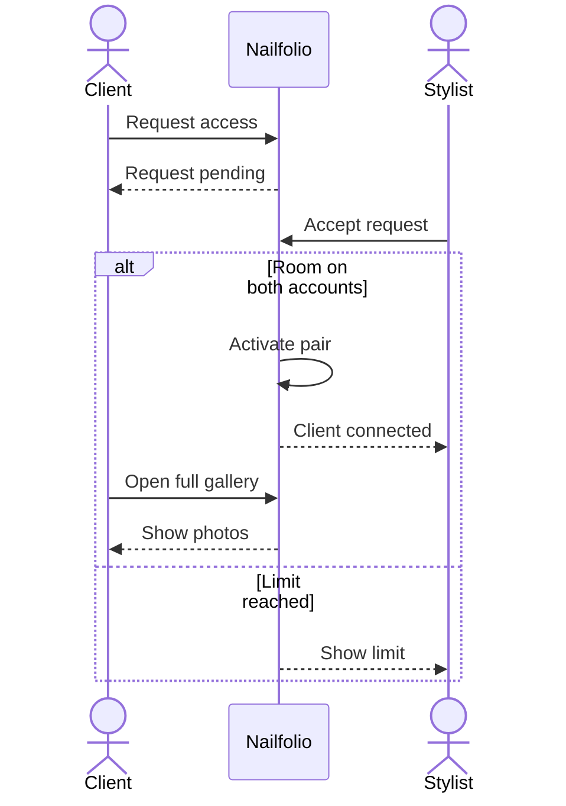
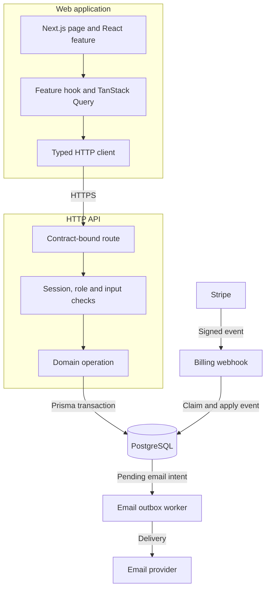
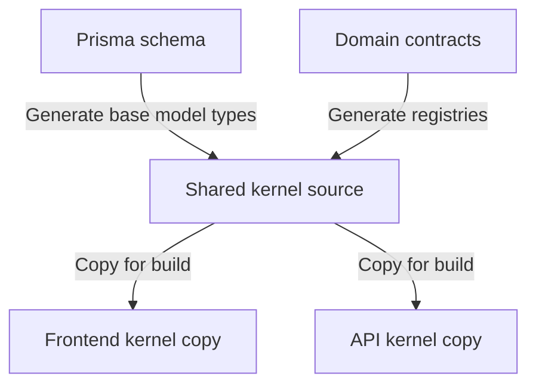

# Nailfolio | SaaS-FRAMEWORK

**English** | [Polski](README.pl.md)

Nailfolio is a portfolio and client management app for nail stylists. A stylist publishes her work and shares a profile link in the salon. A client can open it on her phone, ask to connect and save designs for her next appointment. Behind that interaction are two accounts with different permissions, a public profile, a private gallery and a relationship that either party can end. [Visit Nailfolio](https://nailfolio.app)

I built and operate the product. I define the user flows, design the architecture and decide how to verify a change before accepting it. I use coding agents to implement parts of those plans. This public edition, dated **19 November 2026**, brings the frontend and backend submodules into one repository so a reviewer can follow a feature across both.

| If you are reviewing... | Start here |
| --- | --- |
| Full-stack engineering | Follow a change from the [React application](main/README.md) through the [shared contract](.shared-kernel/domain/pairing/pairing.contracts.ts) to the [HTTP API](web-1/README.md). |
| Product development | Read [how a client gets gallery access](#from-a-salon-visit-to-a-business-rule), then inspect the [two-user browser journey](tests/e2e/journey/stylist-client.journey.ts). |
| Engineering with AI agents | See [how I scope and review agent work](#engineering-with-ai-agents) and the [tests for the contract audit](tests/audit/tools/d1-contracts.test.ts). |

## What lives where

| Module | What it owns |
| --- | --- |
| [Web application](main/README.md) (`main/`) | Next.js Pages Router and React. Public portfolios and search, the stylist and client workspaces, salon management and administration. Feature hooks connect these screens to the API. |
| [HTTP API](web-1/README.md) (`web-1/`) | A separate Next.js application. It authenticates requests with Better Auth, enforces access to individual records and owns writes for galleries, client relationships, messaging and subscriptions. |
| [Shared kernel](.shared-kernel/SHARED_KERNEL_GUIDE.md) (`.shared-kernel/`) | TypeScript contracts, Zod schemas, role grants, domain errors and pure policies shared by both apps. Start with the [pairing definitions](.shared-kernel/domain/pairing/pairing.contracts.ts) to see an entire feature's API together. |
| [Database schema and migrations](web-1/src/prisma/) | Prisma models and PostgreSQL constraints behind the API. [Application logs](web-1/src/prisma-app-logs/) have their own schema. |
| [Engineering tools](scripts/) and [ESLint rules](eslint-rules/) | Generate model types and contract registries, synchronize the kernel and enforce conventions in application code. |
| [Tests and audits](tests/README.md) | Cross-application browser journeys, concurrent API requests and structural checks. Tests for individual operations also live beside their implementation. |
| [Design and planning notes](docs/README.md) | A feature walkthrough and selected historical plans with the original scope, decisions and acceptance criteria. |

## From a salon visit to a business rule

A stylist can print the same profile QR code for every visitor. Knowing that link lets a client find the stylist. Who gets the full gallery, and when does a new client count towards the stylist's subscription limit? I made the stylist's acceptance the point at which both things happen. A client can send a request even when she does not yet know whether a place is available.

- **On screen**, the client sees the status on the profile she just visited. The stylist responds from her own list. The mutation refreshes the affected cached queries so each screen can obtain the new server state. [Client interaction](main/src/UI/features/stylist/hooks/useProfilePairRequest.ts) / [Stylist screen](main/src/UI/features/pairing/StylistPairRequests.organism.tsx) / [Query and mutation hooks](main/src/UI/features/shared/pairing/hooks/usePairRequests.ts)
- **At the API**, the contract reserves the response operation for a stylist. The handler gets the stylist account from the authenticated session. The operation checks that the requested relationship belongs to that account and is still pending. [Contract](.shared-kernel/domain/pairing/pairing.contracts.ts) / [HTTP handler](web-1/src/pages/api/v1/pairing/respond-request/index.ts)
- **In PostgreSQL**, pending requests do not consume a place. Acceptance checks both account limits and changes the relationship inside a serializable transaction. A conditional write guards the transition if two decisions arrive together. [Pairing operation](web-1/src/domain/pairing/operations/pair-request.operations.ts) / [Acceptance, refusal and limit tests](web-1/src/domain/pairing/operations/pair-request.operations.respond.test.ts)
- **In the browser test**, the stylist publishes a photo. A second browser session opens the link encoded by the QR, requests access and sees that same photo after the stylist accepts. The test reads login links from a test mailbox and substitutes the external image service. This lets it inspect the actual gallery each role sees. [Playwright journey](tests/e2e/journey/stylist-client.journey.ts)

What happens to the conversation if the client changes her mind?

A connection request and a conversation have different lifetimes. A client who withdraws her request can return to the existing thread and write again. The browser journey checks that exact sequence. The stylist can also decline a request. The operation keeps the relationship record so declining does not cascade into deletion of message history. That product decision changes how the model is stored in PostgreSQL. [Withdrawal in the browser](tests/e2e/journey/stylist-client.journey.ts) / [Decline operation](web-1/src/domain/pairing/operations/pair-request.operations.ts)

## Architecture and technical decisions

The browser and the HTTP API are separate applications. The client can render a public profile for a search engine, then serve an authenticated workspace when the user signs in. The API makes the final decision about access, writes and billing regardless of which screen initiated a call. These are the runtime paths for a few representative operations.

### One contract across two builds

The acceptance contract names the HTTP method, route, request schema, response schema, allowed outcomes and role. The frontend derives its call with `contractEndpoint`. The API binds the same definition with `defineEndpoint`, which supplies the parsed input and typed response helpers. In development and tests it also checks successful responses against the schema and declared event. A renamed field can therefore surface in the compiler, while a response serialized in the wrong shape can surface in a handler test. [Contract](.shared-kernel/domain/pairing/pairing.contracts.ts) / [Frontend binding](main/src/domain/pairing/pairingIO.possibilities.api.ts) / [Server binding](web-1/src/application/http/define-endpoint.ts)

Both applications build against a local copy. The benefit is that a contract edit and its consumers can be reviewed together without publishing a package. The cost is keeping the two copies synchronized and considering older clients when changing a deployed endpoint. The synchronization audit checks the copies. The contract audit also catches a route bound to the wrong filesystem path. [Build scripts](package.json) / [Synchronization audit](tests/audit/kernel-sync.sh) / [Contract audit fixtures](tests/audit/tools/d1-contracts.test.ts)

### Frontend state, feedback and public pages

TanStack Query owns server data. For example, sending a connection request invalidates the access-status query for that particular stylist. Zustand holds local UI and lifecycle state. A shared event pipeline can display feedback for an API outcome. When a feature supplies its own message, it declares that responsibility so the same error does not produce two notifications. [Pairing hooks](main/src/UI/features/shared/pairing/hooks/usePairRequests.ts) / [Event pipeline](main/src/application/event-bus/eventPipeline.orchestrator.ts) / [Favorite mutation](main/src/UI/features/shared/favorites/hooks/useToggleFavorite.ts)

Public profiles have a different job from a signed-in workspace. A profile also describes a salon to search engines using JSON-LD and approximate public coordinates. The interface has Polish, English and German translations. A locale audit checks that links in the discovery documents lead to pages in the right language. Shared UI components and platform adapters let the web screens also run inside a Capacitor shell. [Profile structured data](main/src/UI/features/stylist/_jsonld.helpers.ts) / [Locale checks](tests/audit/tools/geo-locale-discovery.test.ts) / [UI architecture](main/src/UI/UI_ARCHITECTURE.md) / [Native integration](main/src/UI/NATIVE_INTEGRATION_GUIDE.md)

How a business error reaches the client

A domain operation returns an `OperationResult` with data or a named failure, such as a pairing limit being reached. Each domain maps its errors to HTTP responses. TypeScript requires coverage of the combined error union, and the map composer catches duplicate registrations. The operation can be tested independently of HTTP while the API and frontend retain a consistent response format. [Result type](.shared-kernel/application/result.types.ts) / [Domain error maps](web-1/src/application/http/error-map/domain-error.map.ts) / [Request middleware](web-1/src/application/http/request.middleware.ts)

### Payments, delivery and recovery

| Failure to design for | Decision and evidence |
| --- | --- |
| Stripe delivers the same event twice | Verify the signature against the raw body and fetch external context before opening a database transaction. Claim the event and apply the subscription change in that transaction. A rollback releases both changes. Schedule follow-up effects after commit. [Webhook](web-1/src/pages/api/v1/webhooks/stripe/index.ts) / [Event claim](web-1/src/application/stripe/webhooks/stripe-webhook-claim.ts) |
| A process exits after committing a change but before sending an email | For flows using the transactional outbox, persist the intention to send inside the caller's transaction. A worker picks it up later. PostgreSQL tests cover crashes during delivery and the ambiguous case where the provider accepted a message before the worker recorded the acknowledgement. [Outbox write](web-1/src/application/email-handler/outbox/email-outbox.writes.ts) / [Crash tests](web-1/tests/postgres/email-outbox.crash.test.ts) |
| Two workers try to run the same scheduled job | A renewable database lease identifies the current owner. Another worker can take over after expiry. A test kills an owner process and measures when the next process can claim the job. [Lease SQL](web-1/src/application/scheduler/job-lease.sql.ts) / [Multi-process tests](web-1/tests/postgres/job-lease.test.ts) |
| Concurrent writes contend for the same records | The API documents lock ordering and retries selected database conflicts around the whole transaction. The retried callback must contain only database work, since an external side effect could otherwise run twice. [Lock order](web-1/src/application/db/LOCK_GRAPH.md) / [Write transaction helper](web-1/src/application/db/with-write-tx.ts) |

## Engineering with AI agents

I turn a product decision into a bounded implementation task. I specify who can take the action, what data may change, which failure matters to the user and what evidence I need for review. Coding agents can then work across the named contract, handler and screen. I review the resulting behavior and decide whether it satisfies the product rule. The public examples cover the tools and acceptance criteria I use to direct that work. [Plan template](docs/PLANS_TODO/_PLAN_TEMPLATE.md) / [Feature walkthrough](docs/ADD_NEW_FEATURE_PLAYBOOK.md)

For pairing, a useful assignment is *let the stylist accept a pending request without exceeding either account's limit*. It gives the implementer a decision to preserve, a transaction boundary and an observable outcome for each role. A reviewer can challenge it with a request belonging to a different stylist, an exhausted limit and two overlapping decisions. The operation tests cover business outcomes. The concurrency harness releases requests in parallel and inspects their final database state. [Operation tests](web-1/src/domain/pairing/operations/pair-request.operations.respond.test.ts) / [Concurrency harness](tests/concurrency/README.md)

Some review questions are precise enough to automate. For example, the contract audit inspects whether a route actually binds the declared operation. Its negative fixtures include a file with the expected name only in a comment and a handler mounted at the wrong path. The registry generator has its own failure tests checking that invalid input leaves generated files untouched. These examples show how I give an agent fast, repeatable feedback and how I test the feedback mechanism itself. [Contract audit and fixtures](tests/audit/tools/d1-contracts.test.ts) / [Generator failure tests](scripts/contracts/generator-transaction.test.ts)

## How I verify a change

| Question | Where the answer comes from |
| --- | --- |
| Does the endpoint reject an invalid request? | [Handler integration tests](web-1/src/test-utils/integration/pairing-contract.test.ts) exercise the HTTP boundary with a missing field and an unsupported method. |
| Does the database preserve the rule when requests overlap? | [Concurrency scenarios](tests/concurrency/README.md) issue parallel calls and inspect PostgreSQL. [Outbox crash tests](web-1/tests/postgres/email-outbox.crash.test.ts) exercise failures across process boundaries. |
| Can both people finish the task? | The [two-user journey](tests/e2e/journey/stylist-client.journey.ts) keeps the accounts in separate browser contexts, signs each in and checks the result on screen. |
| Is a proposal already available to users? | The [historical salon profile plan](docs/PLANS_TODO/PLAN_STYLIST_GEO_FIELDS.md) records approximate coordinates as implemented and opening hours as a separate proposal with its own acceptance criteria. |

## About this snapshot

This is a read-only selection from a private product. It includes source, schemas, tests and engineering tools. The full system requires configuration and generated Prisma clients outside the export. The Android shell is separate. Article and media samples are retained from the previous edition. Each edition has one public commit. The code is available for technical evaluation. No license is granted.

**Contact** | Michal Salek | [GitHub](https://github.com/MichalSalek) | contact@michalsalek.com
