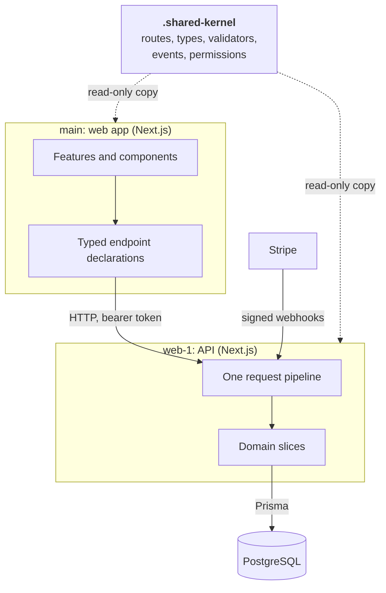
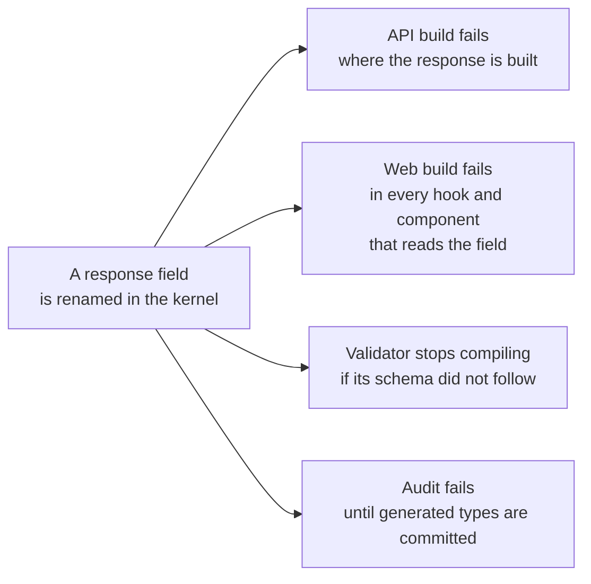
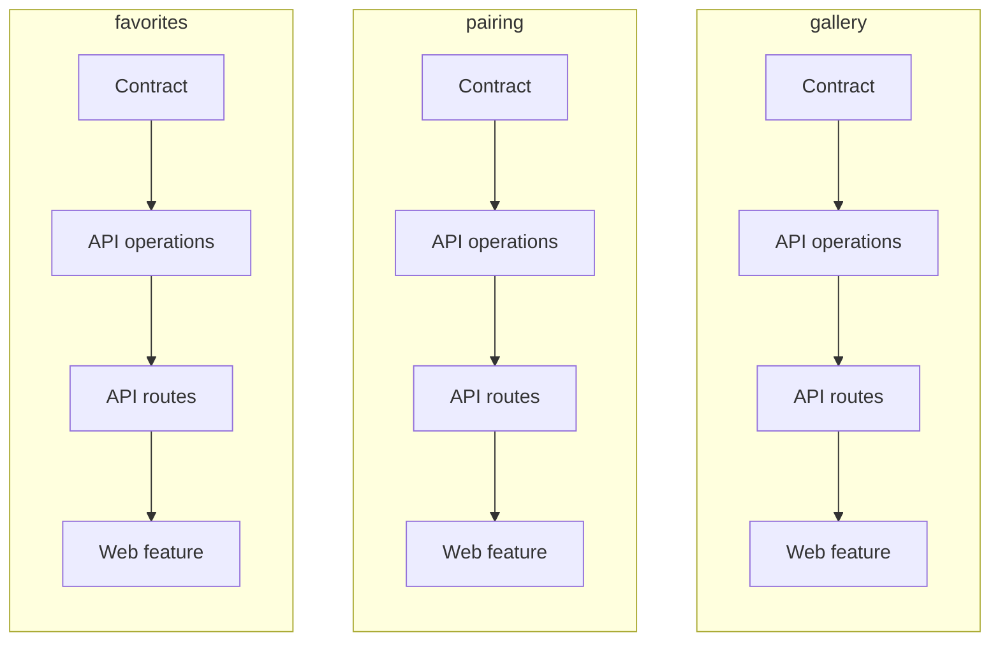
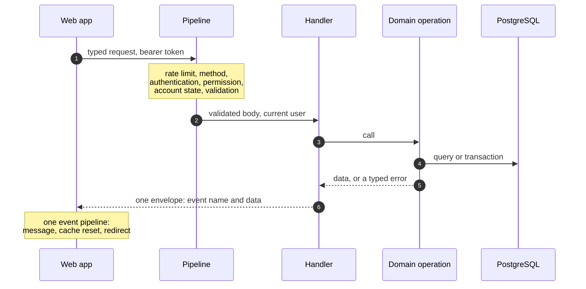
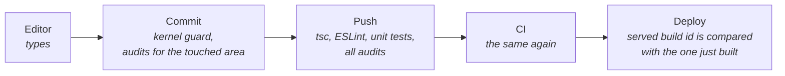
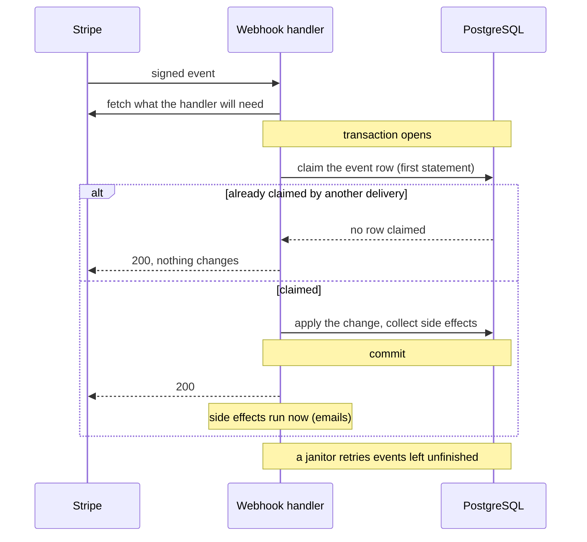
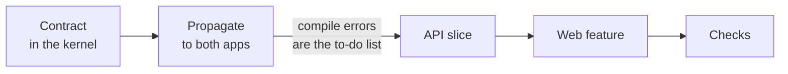

<div align="center">

# SaaS-FRAMEWORK

**A production SaaS codebase built so that mistakes fail the build, not the user.**

**English** | [Polski](README.pl.md)

</div>

> [!NOTE]
> Read-only snapshot (2026-10-10) of the private codebase behind
> [Nailfolio](https://nailfolio.app), a product I design, build and operate alone.
> Published as a work sample. It is meant to be read, not built or run.

I am Michal Salek, a fullstack TypeScript engineer. This repository is the complete
code of one product: a web app, a separate API and the typed contract between them.

| 310,000 | 191 | 43 | 354 | 116 | 0 |
| :-: | :-: | :-: | :-: | :-: | :-: |
| lines of strict TypeScript | API routes | database models | test files | rules enforced by script | `any`, `!` or `@ts-ignore` |

**On this page:** [The idea](#the-idea) | [The shape](#the-shape) |
[Eight principles](#eight-principles) | [Adding a feature](#how-a-feature-is-added) |
[Built to be delegated](#built-to-be-delegated) | [Where to look](#where-to-look) |
[Limits](#limits)

## The idea

Most defects in a product like this are not hard problems. They are omissions:

- the API renamed a field and the web app still reads the old one,
- a new kind of failure was added and one endpoint does not handle it,
- a new endpoint shipped without its permission check,
- a rule everybody knows was skipped under time pressure.

Discipline and code review catch some of them. Here the job is given to machines, in
this order of preference:

1. **The compiler**, when the rule can be written as a type.
2. **A test**, when the rule is behaviour.
3. **A script in a git hook**, when the rule is a convention.

The aim is that whole classes of bugs cannot be written at all, instead of being found
later. The wrong change is hard to write and the right one is the easy path.

"Framework" in the name means that fixed shape, not a library: a generic base (accounts
and roles, authentication, admin panel, billing, email, i18n) that I wrote first, with
one product on top of it.

That product is Nailfolio. It connects nail stylists with their clients: a portfolio
gallery, pairing by QR code, shared inspiration sessions, messaging and subscription
plans. It runs in production. I build it after hours and it has had no public launch
or marketing yet, so judge the engineering, not the business.

## The shape



Two applications, one contract. The web app never guesses what the API accepts or
returns: both compile against the same directory.

**Stack:** strict TypeScript end to end. Next.js 16 (Pages Router) and React 19, a
second Next.js app used only for its API routes, PostgreSQL through Prisma 7, Better
Auth, Stripe subscriptions, TanStack Query, Zustand, CSS Modules, next-intl with three
locales, a Capacitor bridge for an Android shell, Vitest and Playwright.

## Eight principles

| | Principle | What usually happens | What happens here |
| :-: | --- | --- | --- |
| 1 | [One contract, two apps](#1-one-contract-two-apps) | The API and the web app drift apart, and a user finds out first | A changed field breaks the build of both apps |
| 2 | [Failures are values](#2-failures-are-values) | A forgotten `catch` becomes a 500 | A failure is a typed value that must be handled to compile |
| 3 | [The compiler cannot be silenced](#3-the-compiler-cannot-be-silenced) | `any` and `!` spread wherever someone was in a hurry | There are none, and a script rejects the first one |
| 4 | [One name, one place](#4-one-name-one-place) | A feature is smeared across technical layers | A concept is one directory per layer, under one name |
| 5 | [One door for every request](#5-one-door-for-every-request) | Each endpoint repeats its security checks, and one forgets | The handler declares, one pipeline enforces |
| 6 | [Rules are scripts](#6-rules-are-scripts) | Conventions live in heads and erode | 116 scripts fail the commit |
| 7 | [Written for concurrency](#7-written-for-concurrency) | Races show up in production | Lock order, idempotent webhooks, tests with real parallel requests |
| 8 | [Decisions stay with the code](#8-decisions-stay-with-the-code) | A settled question is argued again, or quietly undone | The reason sits on the line it explains |

### 1. One contract, two apps

> **What usually happens.** A web app and an API are two programs that must agree on
> every URL, method, field and error. The agreement lives in documentation and in
> people's heads. It breaks silently: the API ships a change, the web app keeps sending
> the old shape, and a user is the first to notice.

**Here** the agreement is code. One directory, `.shared-kernel/` (a shared kernel, in
domain-driven design terms), holds every route, HTTP method, request and response type,
validator, event name and permission. Both apps compile against it, and neither can
edit its copy.



**What it gives**

- **A changed field breaks both builds**, in every place that touches it. The compile
  errors are the to-do list.
- **The contract cannot go stale.** It is the code that runs, so there is no separate
  API document to forget.
- **Refactoring across the stack is mechanical.** Rename, follow the errors, done.
- **Validation cannot drift from the types.** A zod schema whose shape differs from its
  request type does not compile.
- **The database reaches the UI as types.** Model types are generated from the Prisma
  schema into the kernel, so a changed column surfaces in the web app as a compile error.

The two apps are separate repositories with separate deploys in the private setup, so
the kernel is copied, not published as a package. A pre-commit hook rejects a staged
copy that differs from the source (`scripts/hooks/readonly-guard`), and
`tests/audit/kernel-sync.sh` compares all three trees.

<details>
<summary><b>Follow one endpoint through the contract</b> (five short excerpts)</summary>

<br/>

A client saves a gallery photo to her favourites.

**1. One key joins every registry.**

```ts
// .shared-kernel/domain/routing/routing.config.ts
FAVORITE_ADD_RECORD: `${API_VER}favorite/add-record`,
// .shared-kernel/domain/http/http-methods.config.ts
FAVORITE_ADD_RECORD: 'POST',
// .shared-kernel/domain/events/app-events.const.ts
FAVORITE_ADD_RECORD: 'FAVORITE_ADD_RECORD',
```

The event name is also the permission key. Roles are lists of events
(`.shared-kernel/application/role-permissions.ts`).

**2. The type is derived from the database model.** `scripts/generate-dto` parses
`web-1/src/prisma/schema.prisma` and writes the model types into the kernel. API
contracts pick from them.

```ts
// .shared-kernel/models/favorites/favorite.dto.ts
  FAVORITE_ADD_RECORD: {
    REQUEST: Pick<FavoriteGalleryRecord, 'gallery_record_id'> & {
      note?: string | null;
    };
    RESPONSE: Pick<
      FavoriteGalleryRecord,
      'id' | 'client_user_id' | 'gallery_record_id' | 'note'
    >;
    ...
```

**3. The validator is bound to the type at compile time.** Next to the zod schema sits
a type that resolves to `true` only when the inferred schema type equals the
hand-written request type, so a field added on one side and not the other stops the
build.

```ts
// .shared-kernel/policies/validation/favorite.validation.ts
const favoriteAddRecordSchema = z.object({
  gallery_record_id: z
    .string({ error: V.favorite.invalidRecordId })
    .min(1, V.favorite.invalidRecordId),
  note: optionalNote,
});
...
  favoriteAddRecord: AssertTrue<
    SchemaMatchesDto<
      z.infer<typeof favoriteAddRecordSchema>,
      FAVORITE_DTO_API_V1['FAVORITE_ADD_RECORD']['REQUEST']
    >
  >;
```

**4. The API handler declares its contract and writes only its own logic.**

```ts
// web-1/src/pages/api/v1/favorite/add-record/index.ts (trimmed)
export default defineHandler<
  FAVORITE_DTO_API_V1['FAVORITE_ADD_RECORD']['REQUEST'],
  FAVORITE_DTO_API_V1['FAVORITE_ADD_RECORD']['RESPONSE']
>({
  eventName: APP_EVENTS.COMMANDS.FAVORITE.FAVORITE_ADD_RECORD,
  method: 'post',
  validate: VALIDATION_POLICY.validators.favoriteAddRecord,
  handle: async (body, ctx, metadata, res) => {
    const { currentUser } = requireAuthenticatedContext(ctx);
    ...
    const result = await addRecordToFavorites_IO({ ... });
    if (!result.success) {
      return mapErrorToResponse(res, result.error);
    }
    ...
    respondCreated(res, responsePayload, APP_EVENTS.INFO.FAVORITE.FAVORITE_RECORD_ADDED);
  },
});
```

The second type argument brands `res` with a phantom type, so `respondCreated` accepts
only the declared response type (`web-1/src/application/http/http.responses.utils.ts`).

**5. The web app declares the same contract from the same types.**

```ts
// main/src/domain/favorites/favoriteIO.possibilities.api.ts
export const addRecordToFavorites_IO = defineEndpoint<
  FAVORITE_DTO_API_V1['FAVORITE_ADD_RECORD']['REQUEST'],
  FAVORITE_DTO_API_V1['FAVORITE_ADD_RECORD']['RESPONSE'],
  FAVORITE_DTO_API_V1['FAVORITE_ADD_RECORD']['RESPONSE_ERROR']
>({
  url: ENDPOINTS.FAVORITE_ADD_RECORD,
  mode: 'post',
});
```

Every declaration returns `(req, options?) => Promise<Res>`, ready to be a TanStack
Query `queryFn` or `mutationFn` (`main/src/application/http/io.ts`; the file lists its
few exceptions, such as the direct image upload).

What the compiler cannot see is covered by audits: a route without a handler, method or
permission scope (`endpoint-completeness.sh`), a handler whose method differs from the
registry (`handler-method-consistency.sh`), a handler without a validator
(`validation-coverage.sh`).

</details>

### 2. Failures are values

> **What usually happens.** With exceptions, the type of a function says nothing about
> how it can fail. One forgotten `try/catch` becomes a 500 in production, and every
> endpoint invents its own error response.

**Here** a business operation does not throw a business failure. It returns
`OperationResult<T, E>`: the data, or one error from a closed list. One exhaustive
`switch` turns every possible error into an HTTP response.

```ts
const result = await addRecordToFavorites_IO({ ... });
if (!result.success) {
  return mapErrorToResponse(res, result.error);
}
// result.data exists only past this point: the compiler will not let you skip the branch
```

**What it gives**

- **A failure cannot be forgotten.** The data is unreachable until the error branch is
  written.
- **A new error cannot ship unmapped.** Adding an error variant without its HTTP
  response fails the build (`never` in the default branch of
  `web-1/src/application/http/error-mapper.ts`).
- **One error shape for every client.** The web app turns it into a message, a cache
  reset or a redirect in one place
  (`main/src/application/event-bus/eventPipeline.orchestrator.ts`), not per screen.
- **A 500 means a real fault**, such as a database that is down, and not a business
  rule that nobody handled.

What still throws, on purpose: rollback signals inside a transaction (caught in the
same operation), the authentication guard, and unexpected faults, which the pipeline
turns into one opaque 500.

### 3. The compiler cannot be silenced

> **What usually happens.** Strict types hold only until someone writes `any`, `!` or
> `// @ts-ignore` to get past them. Each one is a place where the types lie, and they
> multiply under deadlines.

**Here** there are none. A script counts `any`, `as any`, the non-null `!`,
`@ts-ignore` and `@ts-expect-error` across both apps, the kernel and the tests. The
allowed count is zero, and unlike a lint rule the script has no disable comment
(`tests/audit/typescript-strictness.sh`). Casting a request body to a type is closed
the same way (`tests/audit/no-body-cast.sh`).

| Layer | What is switched on |
| --- | --- |
| Compiler | `strict`, `exactOptionalPropertyTypes`, `noImplicitReturns`, `noFallthroughCasesInSwitch`, `noUnusedLocals`; the API adds `noUncheckedIndexedAccess` |
| ESLint | Zero warnings allowed. A floating promise or a loose boolean check is an error |
| Audit | Zero `any`, `as any`, `!`, `@ts-ignore`, `@ts-expect-error`, in tests too |

**What it gives**

- **A green build means what it says.** The guarantees on this page are not approximate.
- **Review does not hunt for shortcuts.** There is nowhere to put one.
- **The same floor holds for code written by an agent**, which is what makes
  [delegation](#built-to-be-delegated) workable.

### 4. One name, one place

> **What usually happens.** Code organised only by technical layer (controllers,
> services, models) spreads every feature across the whole tree. To change "favorites"
> you have to know where its six pieces live, and nothing says which pieces belong
> together.

**Here** the idea is borrowed from domain-driven design and kept light: the vocabulary
of the business is the structure of the code. A concept such as favorites, pairing or
gallery has one name, and that name is a directory in every layer, from the contract to
the screen. Each concept is one vertical slice through the stack.



| Layer | Where `favorites` lives |
| --- | --- |
| Contract | `.shared-kernel/models/favorites/`, `.shared-kernel/policies/validation/favorite.validation.ts`, `.shared-kernel/domain/favorites/` |
| API operations | `web-1/src/domain/favorites/operations/` |
| API routes | `web-1/src/pages/api/v1/favorite/*/index.ts`, one directory per operation |
| Web transport | `main/src/domain/favorites/favoriteIO.possibilities.api.ts` |
| Web feature | `main/src/UI/features/favorites/` (page, hooks, components) |
| Tests | `web-1/src/test-utils/integration/favorite-remove-record.test.ts`, `tests/smoke/favorite.smoke.ts` |

**What it gives**

- **You find code by the word the business uses.** No map is needed.
- **A change stays local.** A feature is read, added or removed as one slice. The API
  has 18 of them under `web-1/src/domain/`.
- **Parallel work does not collide.** Two people, or two agents, on two slices touch
  different directories.
- **A name says what a file does before it is opened.** `*.operations.ts` does I/O, a
  function that returns a result ends in `_IO`, a component file carries its level
  (`.atom`, `.molecule`, `.organism`, `.composition`). Audits check each of these.
- **Business rules are separate from plumbing.** HTTP, database, auth and Stripe live in
  `application/`. The domain uses them, and ESLint rejects the opposite direction
  outside a short whitelist.
- **Every action has one name.** The product's capabilities form one dictionary of
  commands and queries. The name of an action is also its permission key, its audit log
  entry and the key of the message the user sees. A role is a list of names.

### 5. One door for every request

> **What usually happens.** When each endpoint does its own authentication, permission
> check and validation, security depends on nobody ever forgetting one. Most
> access-control bugs are omissions, not broken cryptography.

**Here** a handler only declares: which action, which method, which validator. One
pipeline does the rest, in the same order for every route.



**What it gives**

- **A new endpoint is protected by default.** There is no check to forget, because the
  handler does not write one.
- **The order never varies.** Permission is checked before validation, so an anonymous
  caller learns nothing about the shape of the payload.
- **Gaps are caught before a push.** A route without a permission entry, a method or a
  validator fails an audit.
- **Handlers stay short** and hold only the business step.

Code: `web-1/src/application/http/define-handler.ts` and `request.middleware.ts`.

### 6. Rules are scripts

> **What usually happens.** A convention that lives in a document or in a reviewer's
> memory erodes. The mistake that cost a day last year comes back, because nothing
> remembers it.

**Here** a lesson becomes a script. `tests/audit/` holds 116 of them, about 19,500 lines
of shell with a few AST helpers. Hooks run them on commit and on push, and CI runs them
again.



| Area | Examples |
| --- | --- |
| Contract | `kernel-sync.sh`, `dto-completeness.sh`, `endpoint-completeness.sh`, `enum-parity.sh`, `openapi-fresh.sh` |
| Security | `security-idor.sh`, `currentuser-enforcement.sh`, `secret-discipline.sh`, `stripe-claim-first.sh` |
| Database | `prisma-fk-index.sh`, `pagination-tiebreaker.sh`, `lock-discipline.sh`, `archive-cascade-completeness.sh` |
| Code health | `typescript-strictness.sh`, `dead-exports.sh`, `circular-imports.sh` |
| Boundaries | `imports-health.sh`, `io-layer.sh`, `atomic-coverage.sh`, `prisma-access.sh` |
| i18n and UI | `i18n-coverage.sh` (three locales, 5,277 keys each, identical sets), `hex-policy.sh`, `min-font-size.sh` |
| The suite itself | `audit-count.sh`, `audit-selftest.sh` |

**What it gives**

- **A mistake made once is not made twice.** Most audits exist because of an incident,
  and say so in their header.
- **Review time goes to design**, not to checking conventions.
- **The rules teach themselves.** A newcomer, human or agent, learns them from a failing
  check with a message, not from a wiki.
- **Debt only goes down.** An audit that cannot start at zero carries a count. A new
  violation fails, and the count may only be lowered.
- **The checks are checked.** 280 fixture samples prove that an audit fails when it
  should and stays quiet when it should (23 audits are covered so far), and an audit
  pointed at an empty tree fails instead of reporting zero findings.

The catalogue is `tests/audit/README.md`.

### 7. Written for concurrency

> **What usually happens.** Two requests arrive in the same millisecond: both pass the
> quota check, both insert. Stripe delivers the same webhook twice. Tests that send one
> request at a time never see it. Production does.

**Here** code that can race is written for the race.

- **One lock order.** Row locks go through a small set of lock helpers that take them
  in one documented order (`web-1/src/application/db/lock-rows.ts`). An ad-hoc
  `FOR UPDATE` outside those helpers is rejected by `tests/audit/lock-discipline.sh`.
- **The database is the backstop.** An invariant the code checks is also a constraint:
  a partial unique index, non-negative counters.
- **Side effects wait for the commit.** An email is queued during the transaction and
  sent only after it commits.
- **Tests fire real parallel requests** at a running API and then assert on PostgreSQL
  (`tests/concurrency/`).
- **Webhooks are claimed, then processed**, as shown below.



**What it gives**

- A duplicate or concurrent webhook is acknowledged and changes nothing.
- A rolled-back transaction sends no email.
- A plan limit holds when requests arrive together.

### 8. Decisions stay with the code

> **What usually happens.** Why does this endpoint answer 404 and not 403? Why is the
> kernel copied instead of published? When the answer is not next to the code, the
> question is argued again, or the deliberate choice gets "fixed" by the next person.

**Here** more than two thousand `DECISION` comments sit on the line where the question
would come up, each with its reason and often the incident behind it.

**What it gives**

- **Nobody re-argues a settled question**, and nobody quietly undoes one.
- **The reasoning survives** a year of not touching the file.
- **An agent cannot "improve" a deliberate trade-off** without meeting the reason first.

`grep -rn "DECISION" web-1/src/application/auth` is a fair sample.

## How a feature is added

The order is always the same: contract, then API, then web app.



1. **Schema**, if data changes: the Prisma schema and a migration.
2. **Contract in the kernel**: the event name, the route, the HTTP method, the role
   grant, the request and response types, the zod validator, the error types.
3. **Propagate**: `npm run system:kernel`. From here both apps fail to compile wherever
   the new contract is not honoured yet. The errors are the to-do list.
4. **API slice**: the operation returning a result, a case in the error mapper for each
   new error, the handler, the audit event.
5. **Web feature**: the endpoint declaration, a TanStack hook, the components, the
   strings in three locales.
6. **Tests** for every new rule or security gate.
7. **Checks**: typecheck, unit tests, `npm run audit:all`. The hooks repeat them.
8. **Documentation**: roadmap index, domain documents, changelog.

The full procedure with templates is
[`docs/ADD_NEW_FEATURE_PLAYBOOK.md`](docs/ADD_NEW_FEATURE_PLAYBOOK.md).

## Built to be delegated

I write the plans, decide the architecture and review the result. Coding agents write
much of the implementation. The decisions on this page are mine: the contract and its
shape, the security model, the concurrency strategy, and which lessons become rules.

That works because of everything above. An agent that puts a file in the wrong place,
skips a permission, invents a field or silences the compiler is stopped by the same
typecheck, tests and audits that would stop a person. The architecture is older than
the agents: it was built to keep one developer honest, and it turned out to be what
makes delegation safe. What gets past the checks is caught by review or not at all,
which is why the [limits](#limits) are written down.

Work starts as a plan file, is executed step by step under the checks, and ends with a
documentation update and the deletion of the plan. [`docs/`](docs/README.md) has the
map of the private documentation, the playbook and three real plans.

## Where to look

| If you care about | Open | What to notice |
| --- | --- | --- |
| The contract | `.shared-kernel/` | Routes, types, validators, events and permissions in one place |
| The request pipeline | `web-1/src/application/http/define-handler.ts`, `request.middleware.ts` | One factory, one order of checks |
| Typed errors | `.shared-kernel/application/result.types.ts`, `web-1/src/application/http/error-mapper.ts` | One exhaustive switch from error to HTTP |
| Locking | `web-1/src/application/db/lock-rows.ts` | The lock helpers and their order, with a measured correction of an earlier assumption |
| Stripe webhooks | `web-1/src/pages/api/v1/webhooks/stripe/index.ts`, `web-1/src/application/stripe/webhooks/` | Claim first, effects after commit, a janitor for the rest |
| Concurrency tests | `tests/concurrency/` | Parallel HTTP requests, then assertions on the database |
| Handler tests | `web-1/src/test-utils/integration/`, `web-1/src/test-utils/setup.ts` | The real pipeline with four mocked chokepoints |
| Token transport | `web-1/src/application/auth/better-auth/auth-token-bridge.ts` | The client sends a bearer token only. After login a one-time code is exchanged for it, so the token never appears in a URL |
| Background work | `web-1/src/application/interceptors/create-sweep-interceptor.ts` | Throttled sweeps behind real traffic instead of a job runner |
| Environment | `web-1/src/application/environment/env-schema.ts` | Every variable is declared as required, required in production or optional, with a format. Outside development a missing required one or a malformed one stops startup |
| Audit event log | `web-1/src/application/event-log/event-log-io.wrapper.ts` | Keyed by the event dictionary, bodies reduced to an allowlist of keys |
| Web data layer | `main/src/application/http/io.ts`, `main/src/application/event-bus/` | One way to call the API, one place for side effects |
| Deploy gate | `scripts/deploy/_artifact-gate.sh` | The build id served by the origin is compared with the one just built. A mismatch fails the deploy, and an unreadable id is reported for a manual check |
| Location privacy | `web-1/src/domain/account/operations/account-query.operations.ts` | Coordinates leave the API rounded to about 110 m, and the radius filter uses the same rounded values, so a search cannot be used to triangulate an address |
| Audits | `tests/audit/README.md`, `scripts/hooks/pre-push` | The catalogue, and what runs before a push |

## Numbers

Counted on the snapshot date.

| Measure | Count |
| --- | --- |
| TypeScript | about 2,400 files and 310,000 lines, tests included, kernel copies and audit fixtures excluded |
| API route files | 191, of which 177 go through the handler factory |
| Handlers with a compile-time response contract | 162 of 177 |
| Request schemas bound to their type | 107 of 111 |
| API domain slices | 18 |
| Prisma models | 43 in the main schema |
| Kernel files | 166 |
| Test files | 225 in the API, 129 in the web app |
| Cross-stack suites | 40 smoke files, 19 Playwright specs, 7 concurrency suites |
| Audit scripts | 116, with 280 fixture samples |
| Locales | 3, with 5,277 keys each |

## Limits

Things I would point out myself in a review.

- **The API layers are held by a lint rule with a whitelist, not by the compiler.** Ten
  infrastructure files import the domain. They are covered by a short list of path
  patterns with reasons in `web-1/eslint.config.mjs`.
- **The response contract is opt-in.** 15 handlers do not declare it yet, and nothing
  validates responses at runtime.
- **Most audits are pattern checks in shell.** They are a regression floor, not a proof.
  Types and tests carry the real guarantees.
- **The concurrency, smoke and Playwright suites are run by hand.** They need a live API
  and database. Hooks and CI run the unit and handler tests.
- **CQRS and DDD are light on purpose.** Commands and queries are a naming and
  permission scheme, not buses and read models. Operations call Prisma directly. There
  are no repositories or aggregates.
- **The product domain lives inside the kernel next to the generic base.** Building a
  second product on this base means cutting that boundary first.
- **The API is a Next.js app used only for its API routes.** A recorded decision for one
  stack across both apps, to be revisited if a team grows around it.
- **Comments are long and mostly Polish**, the working language of the project. Many
  were drafted by coding agents under my review and cite private session and plan ids.
  I keep them because they record why a line is the way it is.

## What is not in this snapshot

- **Git history.** One commit.
- **Documentation.** About 30,000 lines of product, business and operations documents
  stay private. [`docs/README.md`](docs/README.md) is the map of what exists.
- **Secrets and environments.** Only the `.env.example` templates are included. Server
  names, accounts and credentials of the real infrastructure are replaced with
  placeholders, and so is the legal entity data used by the legal pages.
- **Generated code and other repositories.** The generated Prisma clients, source
  artwork, the instruction layer for coding agents and the Android shell (a separate
  repository) are left out.
- **Some comments.** A few were shortened where they described infrastructure or
  business decisions in detail.

The snapshot is frozen: it will not be updated, and issues and pull requests are not
monitored. The CI workflows are shown as they are in the private repository and do not
run here.

No license is granted. The code is published for reading and evaluation only.

## Contact

Michal Salek, [github.com/MichalSalek](https://github.com/MichalSalek),
contact@michalsalek.com.
