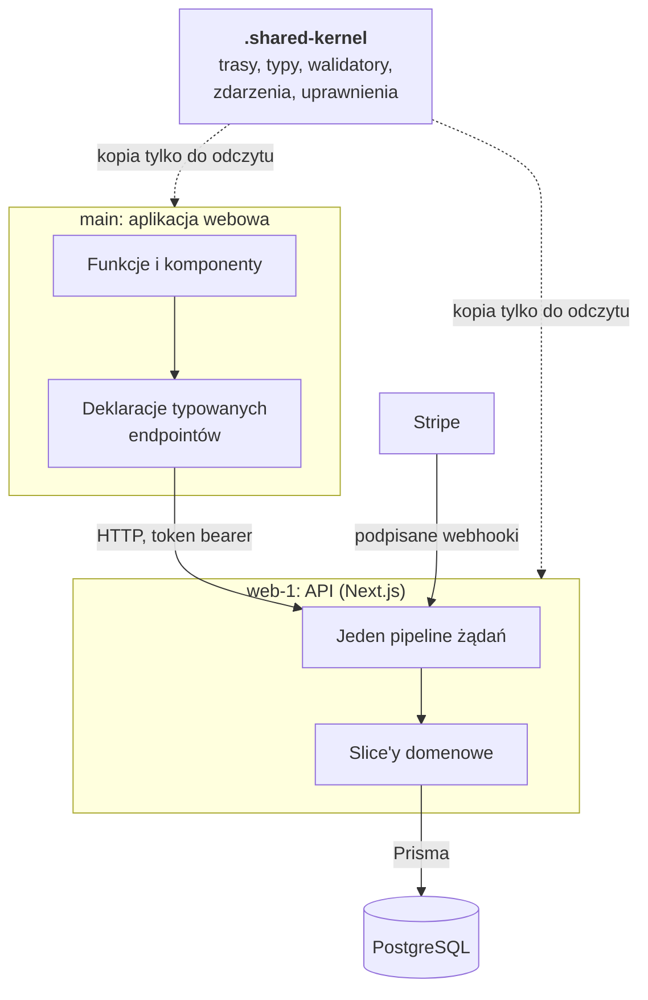
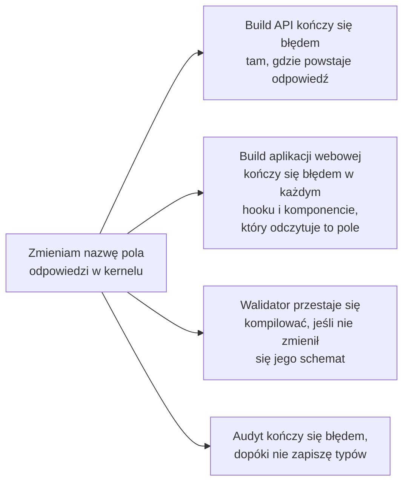
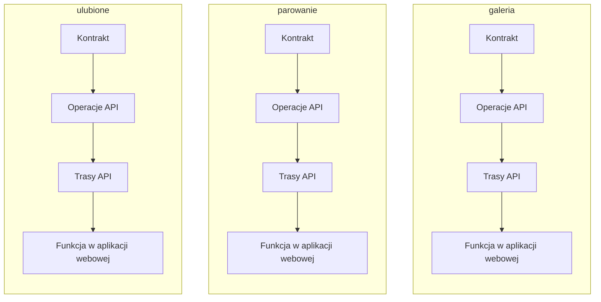
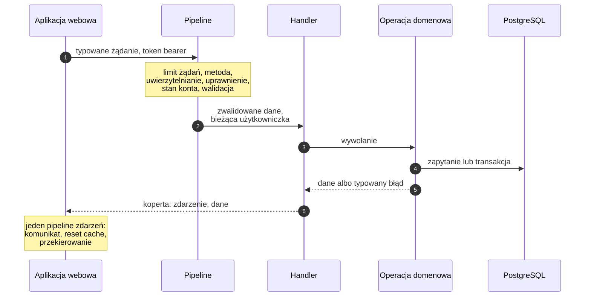
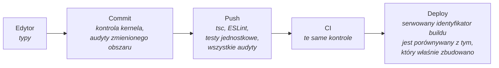
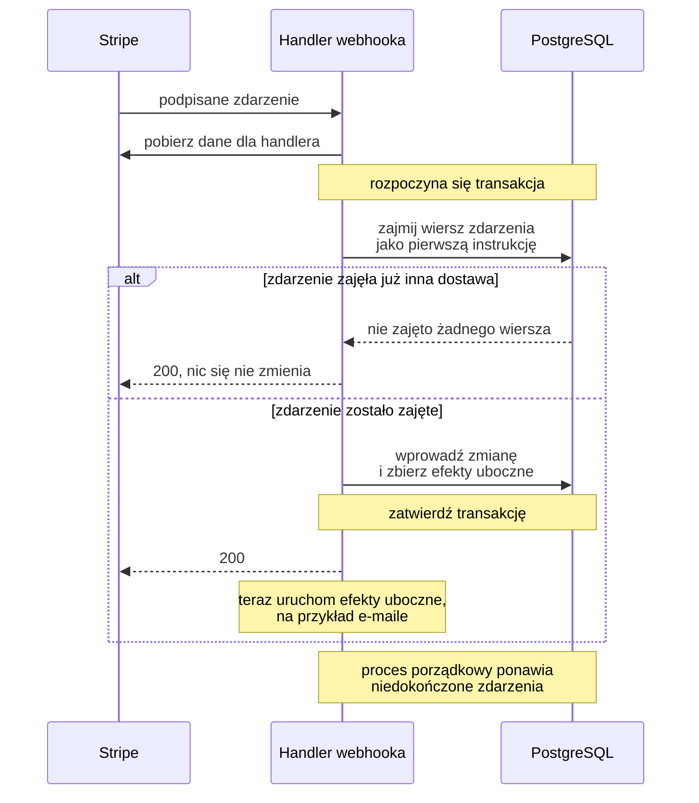
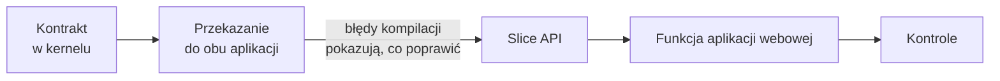

<div align="center">

# SaaS-FRAMEWORK

**Produkcyjny kod SaaS napisany tak, by błędy zatrzymywały build, a nie trafiały do użytkownika.**

[English](README.md) | **Polski**

</div>

> [!NOTE]
> Migawka tylko do odczytu (2026-10-10) prywatnego kodu produktu
> [Nailfolio](https://nailfolio.app), który projektuję, buduję i prowadzę sam.
> Opublikowana jako próbka pracy. Ma służyć do czytania, a nie do budowania ani uruchamiania.

Nazywam się Michał Salek i jestem inżynierem fullstack TypeScript. To repozytorium zawiera kompletny kod jednego produktu: aplikację webową, osobne API i typowany kontrakt między nimi.

| 310 000 | 191 | 43 | 354 | 116 | 0 |
| :-: | :-: | :-: | :-: | :-: | :-: |
| wierszy ścisłego TypeScriptu | endpointów API | modeli bazy danych | plików testowych | reguł egzekwowanych przez skrypt | `any`, `!` lub `@ts-ignore` |

**Na tej stronie:** [Pomysł](#pomysł) | [Kształt](#kształt) |
[Osiem zasad](#osiem-zasad) | [Jak dodaje się nową funkcję](#jak-dodaje-się-nową-funkcję) |
[Zaprojektowane z myślą o delegowaniu](#zaprojektowane-z-myślą-o-delegowaniu) | [Gdzie zajrzeć](#gdzie-zajrzeć) |
[Ograniczenia](#ograniczenia)

## Pomysł

Większość błędów w takim produkcie nie wynika z trudnych problemów. Zwykle ktoś o czymś zapomniał:

- API zmieniło nazwę pola, a aplikacja webowa nadal odczytuje starą,
- dodano nowy rodzaj błędu, ale jeden endpoint go nie obsługuje,
- wdrożono nowy endpoint bez sprawdzania uprawnień,
- pod presją czasu pominięto regułę, którą wszyscy znają.

Dyscyplina i code review wyłapują część takich problemów. Tutaj sprawdzanie powierzam maszynom, według następującej kolejności:

1. **Kompilatorowi**, gdy regułę da się zapisać jako typ.
2. **Testowi**, gdy reguła dotyczy zachowania.
3. **Skryptowi w git hooku**, gdy reguła jest konwencją.

Chodzi o to, by całych kategorii błędów nie dało się w ogóle napisać, zamiast znajdować je dopiero później. Błędną zmianę trudno wprowadzić, a poprawną łatwo.

"Framework" w nazwie oznacza ustalony kształt systemu, a nie bibliotekę: najpierw napisałem ogólną bazę obejmującą konta i role, uwierzytelnianie, panel administracyjny, rozliczenia, pocztę i i18n, a potem zbudowałem na niej jeden produkt.

Tym produktem jest Nailfolio. Łączy stylistki paznokci z ich klientkami. Oferuje galerię prac stylistek, parowanie kodem QR, wspólne sesje inspiracyjne, wiadomości i plany subskrypcji. Działa na produkcji. Buduję go po godzinach i nie miał jeszcze publicznej premiery ani marketingu, dlatego oceniaj inżynierię, a nie biznes.

## Kształt



Dwie aplikacje i jeden kontrakt. Typy w tym samym katalogu określają, jakie dane API przyjmuje i zwraca. Podczas kompilacji korzystają z nich obie aplikacje.

**Stack:** ścisły TypeScript od początku do końca. Next.js 16 (Pages Router) i React 19, druga aplikacja Next.js używana tylko do obsługi tras API, PostgreSQL przez Prisma 7, Better Auth, subskrypcje Stripe, TanStack Query, Zustand, CSS Modules, next-intl w trzech językach, most Capacitor dla powłoki Androida, Vitest i Playwright.

## Osiem zasad

| | Zasada | Co zwykle się dzieje | Co dzieje się tutaj |
| :-: | --- | --- | --- |
| 1 | [Jeden kontrakt, dwie aplikacje](#1-jeden-kontrakt-dwie-aplikacje) | API i aplikacja webowa rozchodzą się, a użytkowniczka jako pierwsza zauważa problem | Zmiana pola zatrzymuje build obu aplikacji |
| 2 | [Błędy są wartościami](#2-błędy-są-wartościami) | Zapomniany `catch` kończy się błędem 500 | Błąd jest typowaną wartością, którą trzeba obsłużyć, żeby kompilacja się powiodła |
| 3 | [Kompilatora nie da się uciszyć](#3-kompilatora-nie-da-się-uciszyć) | `any` i `!` pojawiają się wszędzie, gdzie ktoś się spieszył | Nie ma ich, a skrypt odrzuca już pierwsze wystąpienie |
| 4 | [Jedna nazwa, jedno miejsce](#4-jedna-nazwa-jedno-miejsce) | Funkcja jest rozrzucona po warstwach technicznych | Jeden koncept ma osobny katalog w każdej warstwie i tę samą nazwę |
| 5 | [Jedna brama dla każdego żądania](#5-jedna-brama-dla-każdego-żądania) | Każdy endpoint powtarza kontrole bezpieczeństwa, a w jednym z nich którejś brakuje | Handler deklaruje wymagania, a jeden pipeline je egzekwuje |
| 6 | [Reguły są skryptami](#6-reguły-są-skryptami) | Konwencje pozostają w głowach i z czasem zanikają | 116 skryptów blokuje commit |
| 7 | [Kod pisany z myślą o współbieżności](#7-kod-pisany-z-myślą-o-współbieżności) | Wyścigi ujawniają się na produkcji | Ustalona kolejność blokad, idempotentne webhooki i testy z prawdziwymi równoległymi żądaniami |
| 8 | [Decyzje są zapisane przy kodzie](#8-decyzje-są-zapisane-przy-kodzie) | Rozstrzygnięty temat wraca do dyskusji albo ktoś po cichu zmienia decyzję | Uzasadnienie znajduje się przy kodzie, którego dotyczy |

### 1. Jeden kontrakt, dwie aplikacje

> **Co zwykle się dzieje.** Aplikacja webowa i API to dwa programy, które muszą uzgodnić każdy URL, metodę, pole i błąd. Uzgodnienia trafiają do dokumentacji i do głów ludzi. Łatwo je przeoczyć: API wdraża zmianę, aplikacja webowa nadal wysyła stare dane, a problem jako pierwsza zauważa użytkowniczka.

**Tutaj** uzgodnienia zapisuję w kodzie. Jeden katalog, `.shared-kernel/` (w terminologii domain-driven design to shared kernel), zawiera wszystkie trasy, metody HTTP, typy żądań i odpowiedzi, walidatory, nazwy zdarzeń oraz uprawnienia. Obie aplikacje korzystają z niego podczas kompilacji i żadna nie może edytować swojej kopii.



**Co to daje**

- **Zmiana pola zatrzymuje oba buildy** w każdym miejscu, które z niego korzysta. Błędy kompilacji pokazują, co trzeba poprawić.
- **Kontrakt nie traci aktualności.** Jest działającym kodem, więc nie ma osobnego opisu API, o którym można zapomnieć.
- **Refaktoryzacja w całym stacku jest mechaniczna.** Zmieniam nazwę i poprawiam miejsca wskazane przez błędy kompilacji.
- **Walidacja pozostaje zgodna z typami.** Schemat Zod o innym kształcie niż typ żądania nie skompiluje się.
- **UI korzysta z typów modeli bazy.** Typy modeli są generowane ze schematu Prisma do kernela, więc zmiana kolumny powoduje błąd kompilacji w aplikacji webowej.

W prywatnym projekcie obie aplikacje są osobnymi repozytoriami i mają osobne deploye, dlatego kernel jest kopiowany, a nie publikowany jako pakiet. Pre-commit hook odrzuca kopię dodaną do stage'a, jeśli różni się od źródła (`scripts/hooks/readonly-guard`), a `tests/audit/kernel-sync.sh` porównuje wszystkie trzy drzewa.

<details>
<summary><b>Prześledźmy jeden endpoint w kontrakcie</b> (pięć krótkich fragmentów)</summary>

<br/>

Klientka zapisuje zdjęcie z galerii w ulubionych.

**1. Jeden klucz łączy wszystkie rejestry.**

```ts
// .shared-kernel/domain/routing/routing.config.ts
FAVORITE_ADD_RECORD: `${API_VER}favorite/add-record`,
// .shared-kernel/domain/http/http-methods.config.ts
FAVORITE_ADD_RECORD: 'POST',
// .shared-kernel/domain/events/app-events.const.ts
FAVORITE_ADD_RECORD: 'FAVORITE_ADD_RECORD',
```

Nazwa zdarzenia jest też kluczem uprawnienia. Role są listami zdarzeń
(`.shared-kernel/application/role-permissions.ts`).

**2. Typ wynika z modelu bazy danych.** `scripts/generate-dto` analizuje
`web-1/src/prisma/schema.prisma` i zapisuje typy modeli w kernelu. Kontrakty API
wybierają z nich potrzebne typy.

```ts
// .shared-kernel/models/favorites/favorite.dto.ts
  FAVORITE_ADD_RECORD: {
    REQUEST: Pick<FavoriteGalleryRecord, 'gallery_record_id'> & {
      note?: string | null;
    };
    RESPONSE: Pick<
      FavoriteGalleryRecord,
      'id' | 'client_user_id' | 'gallery_record_id' | 'note'
    >;
    ...
```

**3. Walidator jest powiązany z typem już podczas kompilacji.** Obok schematu zoda znajduje się typ, który przyjmuje wartość `true` tylko wtedy, gdy typ wywnioskowany ze schematu jest równy ręcznie zapisanemu typowi żądania. Jeśli pole zostanie dodane tylko po jednej stronie, build się zatrzyma.

```ts
// .shared-kernel/policies/validation/favorite.validation.ts
const favoriteAddRecordSchema = z.object({
  gallery_record_id: z
    .string({ error: V.favorite.invalidRecordId })
    .min(1, V.favorite.invalidRecordId),
  note: optionalNote,
});
...
  favoriteAddRecord: AssertTrue<
    SchemaMatchesDto<
      z.infer<typeof favoriteAddRecordSchema>,
      FAVORITE_DTO_API_V1['FAVORITE_ADD_RECORD']['REQUEST']
    >
  >;
```

**4. Handler API deklaruje kontrakt i zawiera tylko własną logikę.**

```ts
// web-1/src/pages/api/v1/favorite/add-record/index.ts (skrócone)
export default defineHandler<
  FAVORITE_DTO_API_V1['FAVORITE_ADD_RECORD']['REQUEST'],
  FAVORITE_DTO_API_V1['FAVORITE_ADD_RECORD']['RESPONSE']
>({
  eventName: APP_EVENTS.COMMANDS.FAVORITE.FAVORITE_ADD_RECORD,
  method: 'post',
  validate: VALIDATION_POLICY.validators.favoriteAddRecord,
  handle: async (body, ctx, metadata, res) => {
    const { currentUser } = requireAuthenticatedContext(ctx);
    ...
    const result = await addRecordToFavorites_IO({ ... });
    if (!result.success) {
      return mapErrorToResponse(res, result.error);
    }
    ...
    respondCreated(res, responsePayload, APP_EVENTS.INFO.FAVORITE.FAVORITE_RECORD_ADDED);
  },
});
```

Drugi argument typu nadaje `res` typ phantom, więc `respondCreated` przyjmuje tylko zadeklarowany typ odpowiedzi (`web-1/src/application/http/http.responses.utils.ts`).

**5. Aplikacja webowa deklaruje ten sam kontrakt, korzystając z tych samych typów.**

```ts
// main/src/domain/favorites/favoriteIO.possibilities.api.ts
export const addRecordToFavorites_IO = defineEndpoint<
  FAVORITE_DTO_API_V1['FAVORITE_ADD_RECORD']['REQUEST'],
  FAVORITE_DTO_API_V1['FAVORITE_ADD_RECORD']['RESPONSE'],
  FAVORITE_DTO_API_V1['FAVORITE_ADD_RECORD']['RESPONSE_ERROR']
>({
  url: ENDPOINTS.FAVORITE_ADD_RECORD,
  mode: 'post',
});
```

Każda deklaracja zwraca `(req, options?) => Promise<Res>`, gotowe do użycia jako `queryFn` lub `mutationFn` TanStack Query (`main/src/application/http/io.ts`). Ten plik wymienia też kilka wyjątków, na przykład bezpośrednie przesyłanie obrazu.

Audytami sprawdzam to, czego kompilator nie widzi: trasę bez handlera, metody lub zakresu uprawnień (`endpoint-completeness.sh`), handlera z metodą inną niż w rejestrze (`handler-method-consistency.sh`) oraz handlera bez walidatora (`validation-coverage.sh`).

</details>

### 2. Błędy są wartościami

> **Co zwykle się dzieje.** Przy wyjątkach typ funkcji nie mówi nic o tym, jak może ona zawieść. Wystarczy jedno pominięte `try/catch`, by na produkcji pojawił się błąd 500, a każdy endpoint tworzy własny format odpowiedzi błędu.

**Tutaj** operacja biznesowa nie rzuca błędu biznesowego. Zwraca `OperationResult<T, E>`: dane albo jeden błąd z zamkniętej listy. Jeden wyczerpujący `switch` zamienia każdy możliwy błąd na odpowiedź HTTP.

```ts
const result = await addRecordToFavorites_IO({ ... });
if (!result.success) {
  return mapErrorToResponse(res, result.error);
}
// result.data istnieje dopiero od tego miejsca: kompilator nie pozwoli pominąć tej gałęzi
```

**Co to daje**

- **Nie da się pominąć obsługi błędu.** Dane są niedostępne, dopóki kod nie obsłuży gałęzi błędu.
- **Nowy błąd nie trafi do wdrożenia bez mapowania.** Dodanie wariantu błędu bez odpowiedzi HTTP zatrzymuje build (`never` w domyślnej gałęzi
  `web-1/src/application/http/error-mapper.ts`).
- **Każdy klient API dostaje błąd w tym samym formacie.** Aplikacja webowa zamienia go w komunikat, reset cache albo przekierowanie w jednym miejscu
  (`main/src/application/event-bus/eventPipeline.orchestrator.ts`), a nie osobno na każdym ekranie.
- **Błąd 500 oznacza rzeczywistą awarię**, na przykład niedostępną bazę danych, a nie nieobsłużoną regułę biznesową.

Operacja celowo rzuca wyjątek w kilku sytuacjach: przy sygnale wycofania transakcji (przechwytywanym w tej samej operacji), w strażniku uwierzytelniania oraz przy nieoczekiwanej awarii, którą pipeline zamienia w ogólny błąd 500 bez szczegółów.

### 3. Kompilatora nie da się uciszyć

> **Co zwykle się dzieje.** Ścisłe typy obowiązują tylko do chwili, gdy ktoś dopisze `any`, `!` albo `// @ts-ignore`, żeby ominąć problem. Każdy taki zapis sprawia, że typy kłamią, a pod presją terminu takich miejsc przybywa.

**Tutaj** nie ma takich zapisów. Skrypt liczy `any`, `as any`, operator non-null `!`, `@ts-ignore` i `@ts-expect-error` w obu aplikacjach, kernelu i testach. Dozwolona liczba wynosi zero, a w odróżnieniu od reguły linta skryptu nie da się wyłączyć komentarzem (`tests/audit/typescript-strictness.sh`). W ten sam sposób blokuję rzutowanie treści żądania na typ (`tests/audit/no-body-cast.sh`).

| Warstwa | Włączone ustawienia |
| --- | --- |
| Kompilator | `strict`, `exactOptionalPropertyTypes`, `noImplicitReturns`, `noFallthroughCasesInSwitch`, `noUnusedLocals`; API dodaje `noUncheckedIndexedAccess` |
| ESLint | Nie są dozwolone żadne ostrzeżenia. Błąd stanowi zarówno nieobsłużony Promise, jak i zbyt luźne sprawdzenie wartości logicznej |
| Audyt | Zero `any`, `as any`, `!`, `@ts-ignore`, `@ts-expect-error`, również w testach |

**Co to daje**

- **Zielony build oznacza dokładnie to, co mówi.** Gwarancje opisane na tej stronie nie są przybliżone.
- **Podczas review nie trzeba szukać skrótów.** Nie ma gdzie ich ukryć.
- **Ten sam poziom obowiązuje kod napisany przez agenta**, dzięki czemu [delegowanie](#zaprojektowane-z-myślą-o-delegowaniu) działa.

### 4. Jedna nazwa, jedno miejsce

> **Co zwykle się dzieje.** Kod zorganizowany wyłącznie według warstw technicznych (kontrolery, serwisy, modele) rozrzuca każdą funkcję po całym drzewie. Żeby zmienić ulubione, trzeba wiedzieć, gdzie jest sześć powiązanych elementów, a nic nie wskazuje, które z nich tworzą całość.

**Tutaj** korzystam z pomysłu domain-driven design, ale w lekkiej formie: słownictwo biznesowe wyznacza strukturę kodu. Pojęcie takie jak ulubione, parowanie czy galeria ma jedną nazwę, która staje się nazwą katalogu w każdej warstwie, od kontraktu po ekran. Każdy koncept tworzy pionowy slice (vertical slice) przez cały stack.



| Warstwa | Gdzie znajduje się `favorites` |
| --- | --- |
| Kontrakt | `.shared-kernel/models/favorites/`, `.shared-kernel/policies/validation/favorite.validation.ts`, `.shared-kernel/domain/favorites/` |
| Operacje API | `web-1/src/domain/favorites/operations/` |
| Trasy API | `web-1/src/pages/api/v1/favorite/*/index.ts`, osobny katalog dla każdej operacji |
| Transport aplikacji webowej | `main/src/domain/favorites/favoriteIO.possibilities.api.ts` |
| Funkcja aplikacji webowej | `main/src/UI/features/favorites/` (strona, hooki, komponenty) |
| Testy | `web-1/src/test-utils/integration/favorite-remove-record.test.ts`, `tests/smoke/favorite.smoke.ts` |

**Co to daje**

- **Kod można znaleźć po nazwie używanej w biznesie.** Nie trzeba korzystać z mapy.
- **Zmiana pozostaje w jednym miejscu.** Funkcję można przeczytać, dodać albo usunąć jako jeden slice. API ma ich 18 w `web-1/src/domain/`.
- **Praca równoległa nie prowadzi do konfliktów.** Dwie osoby albo dwóch agentów mogą pracować nad różnymi slice'ami w osobnych katalogach.
- **Nazwa pliku wyjaśnia jego rolę jeszcze przed otwarciem.** Plik `*.operations.ts` obsługuje I/O, funkcja zwracająca wynik kończy się na `_IO`, a plik komponentu wskazuje jego poziom (`.atom`, `.molecule`, `.organism`, `.composition`). Audyty sprawdzają każdą z tych reguł.
- **Reguły biznesowe są oddzielone od infrastruktury.** HTTP, baza danych, uwierzytelnianie i Stripe znajdują się w `application/`. Domena z nich korzysta, a ESLint odrzuca zależności w przeciwnym kierunku poza krótką listą wyjątków.
- **Każda akcja ma jedną nazwę.** Możliwości produktu tworzą jeden słownik komend i zapytań. Nazwa akcji jest jednocześnie kluczem uprawnienia, wpisem w logu audytowym i kluczem komunikatu dla użytkowniczki. Rola jest listą nazw.

### 5. Jedna brama dla każdego żądania

> **Co zwykle się dzieje.** Gdy każdy endpoint samodzielnie uwierzytelnia, sprawdza uprawnienia i waliduje dane, bezpieczeństwo zależy od tego, czy nikt o niczym nie zapomni. Większość błędów kontroli dostępu wynika z pominięć, a nie ze złamanej kryptografii.

**Tutaj** handler jedynie deklaruje, jakiej akcji, metody i walidatora używa. Jeden pipeline wykonuje pozostałe kroki, zawsze w tej samej kolejności.



**Co to daje**

- **Nowy endpoint jest domyślnie chroniony.** Nie można zapomnieć o kontroli, bo handler jej nie zapisuje.
- **Kolejność kontroli się nie zmienia.** Uprawnienie sprawdzam przed walidacją, więc anonimowa osoba nie pozna kształtu danych wejściowych.
- **Braki wychodzą na jaw przed pushem.** Audyt kończy się błędem, gdy trasie brakuje wpisu uprawnień, metody albo walidatora.
- **Handlery pozostają krótkie** i zawierają tylko krok biznesowy.

Kod: `web-1/src/application/http/define-handler.ts` i `request.middleware.ts`.

### 6. Reguły są skryptami

> **Co zwykle się dzieje.** Konwencja opisana w dokumencie albo zapamiętana przez osobę robiącą review z czasem zanika. Błąd, który rok temu kosztował dzień pracy, wraca, bo nic o nim nie pamięta.

**Tutaj** zamieniam wnioski w skrypty. Katalog `tests/audit/` zawiera 116 skryptów, około 19 500 wierszy kodu shell i kilka helperów AST. Hooki uruchamiają je przy commicie i pushu, a CI powtarza te kontrole.



| Obszar | Przykłady |
| --- | --- |
| Kontrakt | `kernel-sync.sh`, `dto-completeness.sh`, `endpoint-completeness.sh`, `enum-parity.sh`, `openapi-fresh.sh` |
| Bezpieczeństwo | `security-idor.sh`, `currentuser-enforcement.sh`, `secret-discipline.sh`, `stripe-claim-first.sh` |
| Baza danych | `prisma-fk-index.sh`, `pagination-tiebreaker.sh`, `lock-discipline.sh`, `archive-cascade-completeness.sh` |
| Jakość kodu | `typescript-strictness.sh`, `dead-exports.sh`, `circular-imports.sh` |
| Granice | `imports-health.sh`, `io-layer.sh`, `atomic-coverage.sh`, `prisma-access.sh` |
| i18n i UI | `i18n-coverage.sh` (trzy języki, po 5277 kluczy w każdym, identyczne zestawy), `hex-policy.sh`, `min-font-size.sh` |
| Same audyty | `audit-count.sh`, `audit-selftest.sh` |

**Co to daje**

- **Raz popełniony błąd nie powraca.** Większość audytów powstała po incydencie i ma o nim informację w nagłówku.
- **Review skupia się na projekcie rozwiązania**, a nie na sprawdzaniu konwencji.
- **Komunikaty z kontroli objaśniają reguły.** Nowa osoba, człowiek albo agent, poznaje je dzięki komunikatowi z kontroli, która nie przeszła, a nie dzięki wiki.
- **Dług techniczny tylko maleje.** Audyt, którego nie da się rozpocząć od zera, ma ustalony limit naruszeń. Każde nowe naruszenie zatrzymuje kontrolę, a limit można tylko obniżać.
- **Kontrole też są sprawdzane.** 280 próbek testowych potwierdza, że audyt kończy się błędem, gdy powinien, i nie zgłasza problemu, gdy wszystko jest w porządku (na razie objęto nimi 23 audyty). Audyt uruchomiony na pustym drzewie również kończy się błędem, zamiast zgłaszać zero problemów.

Spis audytów znajduje się w `tests/audit/README.md`.

### 7. Kod pisany z myślą o współbieżności

> **Co zwykle się dzieje.** Dwa żądania przychodzą w tej samej milisekundzie: oba przechodzą kontrolę limitu i oba zapisują dane. Stripe dostarcza ten sam webhook dwa razy. Testy wysyłające po jednym żądaniu tego nie wykrywają. Produkcja wykrywa.

**Tutaj** piszę kod podatny na wyścigi z myślą o tym, że do nich dojdzie.

- **Jedna kolejność blokad.** Blokady wierszy są zakładane przez niewielki zestaw funkcji pomocniczych, które stosują jedną udokumentowaną kolejność (`web-1/src/application/db/lock-rows.ts`). Doraźne użycie `FOR UPDATE` poza nimi odrzuca `tests/audit/lock-discipline.sh`.
- **Baza danych stanowi zabezpieczenie.** Niezmiennik sprawdzany przez kod jest też ograniczeniem bazy, na przykład częściowym unikalnym indeksem albo nieujemnym licznikiem.
- **Efekty uboczne czekają na commit.** Wiadomość e-mail jest dodawana do kolejki podczas transakcji, ale wysyłam ją dopiero po zatwierdzeniu transakcji.
- **Testy wysyłają prawdziwe równoległe żądania** do działającego API, a następnie sprawdzają stan PostgreSQL (`tests/concurrency/`).
- **Wiersz zdarzenia jest najpierw zajmowany, a dopiero potem webhook jest przetwarzany**, jak pokazuje diagram.



**Co to daje**

- Duplikat lub równoległy webhook zostaje potwierdzony i niczego nie zmienia.
- Wycofana transakcja nie wysyła e-maila.
- Limit planu jest zachowany, gdy żądania przychodzą równocześnie.

### 8. Decyzje są zapisane przy kodzie

> **Co zwykle się dzieje.** Dlaczego ten endpoint odpowiada błędem 404, a nie 403? Dlaczego kernel jest kopiowany, a nie publikowany? Gdy odpowiedź nie znajduje się przy kodzie, temat wraca do dyskusji albo kolejna osoba "naprawia" świadomy wybór.

**Tutaj** ponad dwa tysiące komentarzy `DECISION` znajduje się przy liniach, które mogłyby wywołać takie pytania. Każdy komentarz podaje uzasadnienie, a często także opis incydentu, który doprowadził do decyzji.

**Co to daje**

- **Nikt nie otwiera ponownie rozstrzygniętego tematu** ani po cichu nie zmienia decyzji.
- **Uzasadnienie przetrwa** rok bez zmian w danym pliku.
- **Agent nie "ulepszy" świadomego kompromisu** bez zapoznania się z jego uzasadnieniem.

`grep -rn "DECISION" web-1/src/application/auth` to reprezentatywny przykład.

## Jak dodaje się nową funkcję

Kolejność jest zawsze taka sama: najpierw kontrakt, potem API, a na końcu aplikacja webowa.



1. **Schemat**, jeśli zmieniają się dane: schemat Prisma i migracja.
2. **Kontrakt w kernelu**: nazwa zdarzenia, trasa, metoda HTTP, uprawnienie roli, typy żądania i odpowiedzi, walidator zoda oraz typy błędów.
3. **Przekazanie zmian**: `npm run system:kernel`. Od tego momentu obie aplikacje nie kompilują się tam, gdzie nie respektują nowego kontraktu. Błędy pokazują, co trzeba poprawić.
4. **Slice API**: operacja zwracająca wynik, przypadek w mapperze błędów dla każdego nowego błędu, handler i zdarzenie audytowe.
5. **Funkcja w aplikacji webowej**: deklaracja endpointu, hook TanStack, komponenty i teksty w trzech językach.
6. **Testy** dla każdej nowej reguły lub kontroli bezpieczeństwa.
7. **Kontrole**: typecheck, testy jednostkowe, `npm run audit:all`. Hooki powtarzają te kontrole.
8. **Dokumentacja**: indeks roadmapy, dokumenty domenowe i changelog.

Pełna procedura z szablonami znajduje się w
[`docs/ADD_NEW_FEATURE_PLAYBOOK.md`](docs/ADD_NEW_FEATURE_PLAYBOOK.md) (po angielsku).

## Zaprojektowane z myślą o delegowaniu

Piszę plany, podejmuję decyzje dotyczące architektury i sprawdzam wyniki. Agenci kodujący wykonują dużą część implementacji. Decyzje opisane na tej stronie są moje: kontrakt i jego kształt, model bezpieczeństwa, strategia współbieżności oraz to, które wnioski stają się regułami.

To działa dzięki opisanym wyżej zasadom. Agent, który umieści plik w złym miejscu, pominie uprawnienie, wymyśli pole albo uciszy kompilator, zatrzyma się na tych samych kontrolach typów, testach i audytach co człowiek. Architektura powstała wcześniej niż agenci: miała pomóc jednemu programiście pilnować jakości, a z czasem okazała się tym, co pozwala bezpiecznie delegować pracę. Błędy, które przejdą kontrole, wyłapie review albo pozostaną niezauważone. Dlatego opisuję [ograniczenia](#ograniczenia).

Praca zaczyna się od pliku z planem, jest realizowana krok po kroku pod kontrolą skryptów, a kończy się aktualizacją dokumentacji i usunięciem planu. [`docs/`](docs/README.md) zawiera mapę prywatnej dokumentacji, playbook i trzy rzeczywiste plany.

## Gdzie zajrzeć

| Jeśli interesuje cię | Otwórz | Zwróć uwagę na |
| --- | --- | --- |
| Kontrakt | `.shared-kernel/` | Trasy, typy, walidatory, zdarzenia i uprawnienia w jednym miejscu |
| Pipeline żądań | `web-1/src/application/http/define-handler.ts`, `request.middleware.ts` | Jedna fabryka i jedna kolejność kontroli |
| Typowane błędy | `.shared-kernel/application/result.types.ts`, `web-1/src/application/http/error-mapper.ts` | Jeden wyczerpujący switch zamieniający błąd na odpowiedź HTTP |
| Blokady | `web-1/src/application/db/lock-rows.ts` | Funkcje pomocnicze blokad i ich kolejność oraz zmierzona korekta wcześniejszego założenia |
| Webhooki Stripe | `web-1/src/pages/api/v1/webhooks/stripe/index.ts`, `web-1/src/application/stripe/webhooks/` | Najpierw zajęcie zdarzenia, skutki po zatwierdzeniu transakcji i proces porządkowy dla pozostałych zdarzeń |
| Testy współbieżności | `tests/concurrency/` | Równoległe żądania HTTP, a potem sprawdzenie bazy danych |
| Testy handlerów | `web-1/src/test-utils/integration/`, `web-1/src/test-utils/setup.ts` | Prawdziwy pipeline, w którym zamockowane są tylko cztery miejsca |
| Transport tokenu | `web-1/src/application/auth/better-auth/auth-token-bridge.ts` | Klient wysyła wyłącznie token bearer. Po zalogowaniu jednorazowy kod jest wymieniany na token, który nigdy nie pojawia się w URL |
| Zadania w tle | `web-1/src/application/interceptors/create-sweep-interceptor.ts` | Zadania porządkowe z ograniczeniem częstotliwości, uruchamiane za prawdziwym ruchem zamiast osobnego job runnera |
| Środowisko | `web-1/src/application/environment/env-schema.ts` | Każda zmienna jest zadeklarowana jako wymagana, wymagana na produkcji albo opcjonalna i ma określony format. Poza środowiskiem deweloperskim brak wymaganej zmiennej albo zły format zatrzymuje start aplikacji |
| Log zdarzeń audytowych | `web-1/src/application/event-log/event-log-io.wrapper.ts` | Klucze pochodzą ze słownika zdarzeń, a treść ograniczam do dozwolonej listy kluczy |
| Warstwa danych aplikacji webowej | `main/src/application/http/io.ts`, `main/src/application/event-bus/` | Jeden sposób wywoływania API i jedno miejsce na efekty uboczne |
| Bramka deployu | `scripts/deploy/_artifact-gate.sh` | Identyfikator buildu serwowany przez origin jest porównywany z tym, który właśnie zbudowano. Niezgodność przerywa deploy, a brak odczytu jest zgłaszany do ręcznego sprawdzenia |
| Prywatność lokalizacji | `web-1/src/domain/account/operations/account-query.operations.ts` | Współrzędne wychodzą z API zaokrąglone do około 110 m, a filtr promienia liczy na tych samych zaokrąglonych wartościach, więc wyszukiwaniem nie da się namierzyć adresu |
| Audyty | `tests/audit/README.md`, `scripts/hooks/pre-push` | Katalog audytów i kontrole uruchamiane przed pushem |

## Liczby

Wartości policzone w dniu migawki.

| Miara | Liczba |
| --- | --- |
| TypeScript | około 2400 plików i 310 000 wierszy, łącznie z testami, bez kopii kernela i fixture'ów audytów |
| Pliki tras API | 191, z czego 177 korzysta z fabryki handlerów |
| Handlery z kontraktem odpowiedzi sprawdzanym podczas kompilacji | 162 ze 177 |
| Schematy żądań powiązane z ich typem | 107 ze 111 |
| Slice'y domenowe API | 18 |
| Modele Prisma | 43 w głównym schemacie |
| Pliki kernela | 166 |
| Pliki testowe | 225 w API i 129 w aplikacji webowej |
| Zestawy testów dla całego stacku | 40 plików smoke, 19 specyfikacji Playwright i 7 zestawów testów współbieżności |
| Skrypty audytów | 116 i 280 próbek testowych |
| Języki | 3, po 5277 kluczy każdy |

## Ograniczenia

To kwestie, które sam wskazałbym podczas review.

- **Warstwy API są pilnowane regułą linta z listą wyjątków, a nie przez kompilator.** Dziesięć plików infrastruktury importuje domenę. Ogranicza je krótka lista wzorców ścieżek z uzasadnieniami w `web-1/eslint.config.mjs`.
- **Kontrakt odpowiedzi jest opcjonalny.** 15 handlerów jeszcze go nie deklaruje, a odpowiedzi nie są walidowane w runtime.
- **Większość audytów sprawdza wzorce w shellu.** To zabezpieczenie przed regresją, a nie dowód poprawności. Właściwe gwarancje zapewniają typy i testy.
- **Zestawy testów współbieżności, smoke i Playwright uruchamiam ręcznie.** Wymagają działającego API i bazy danych. Hooki i CI uruchamiają testy jednostkowe oraz testy handlerów.
- **CQRS i DDD stosuję w lekkiej formie.** Komendy i zapytania to konwencja nazewnictwa oraz uprawnień, a nie osobne busy i modele odczytu. Operacje wywołują Prisma bezpośrednio. Nie ma repozytoriów ani agregatów.
- **Domena produktu znajduje się w kernelu obok ogólnej bazy.** Zanim zbuduję na tej bazie drugi produkt, muszę najpierw wyznaczyć tę granicę.
- **API jest aplikacją Next.js używaną wyłącznie do obsługi tras API.** Taką decyzję o wspólnym stacku dla obu aplikacji zapisałem wcześniej. Wrócę do niej, jeśli wokół projektu powstanie zespół.
- **Komentarze są długie i w większości po polsku**, bo to język pracy w projekcie. Wiele z nich przygotowali agenci kodujący, a ja je sprawdziłem. Odnoszą się do prywatnych identyfikatorów sesji i planów. Zostawiam je, bo wyjaśniają, dlaczego dany fragment działa właśnie w ten sposób.

## Czego nie obejmuje ta migawka

- **Historia Gita.** Jeden commit.
- **Dokumentacja.** Około 30 000 wierszy dokumentów produktowych, biznesowych i operacyjnych pozostaje prywatnych. [`docs/README.md`](docs/README.md) zawiera mapę tego, co istnieje.
- **Sekrety i środowiska.** Dołączone są tylko szablony `.env.example`. Nazwy serwerów, konta i dane dostępowe do prawdziwej infrastruktury zastąpiono wartościami przykładowymi, podobnie jak dane podmiotu prawnego używane na stronach prawnych.
- **Wygenerowany kod i inne repozytoria.** Nie dołączam wygenerowanych klientów Prisma, grafik źródłowych, instrukcji dla agentów kodujących ani powłoki Androida, która znajduje się w osobnym repozytorium.
- **Część komentarzy.** Kilka skróciłem, gdy szczegółowo opisywały infrastrukturę lub decyzje biznesowe.

Migawka jest zamrożona: nie będzie aktualizowana, a zgłoszenia błędów i pull requesty nie są monitorowane. Workflowy CI pokazuję w postaci z prywatnego repozytorium, ale tutaj się nie uruchamiają.

Nie udzielam licencji. Kod publikuję wyłącznie do czytania i oceny.

## Kontakt

Michał Salek, [github.com/MichalSalek](https://github.com/MichalSalek),
contact@michalsalek.com.

