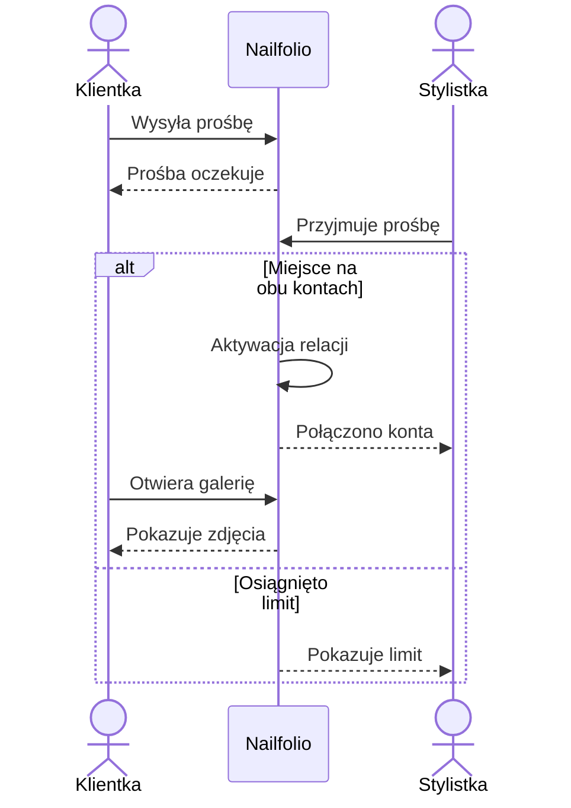
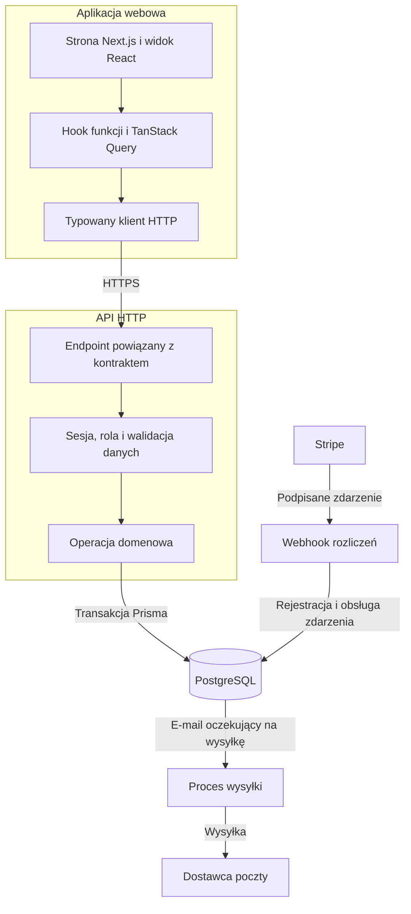
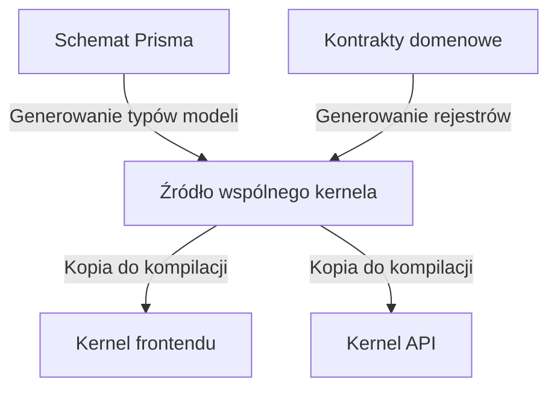

# Nailfolio | SaaS-FRAMEWORK

[English](README.md) | **Polski**

Nailfolio to aplikacja, w której stylistka paznokci prowadzi portfolio i zarządza relacjami z klientkami. Publikuje zdjęcia swoich prac i udostępnia w salonie link do profilu. Klientka otwiera go na telefonie, prosi o połączenie i może zapisać wzory na kolejną wizytę. Ten prosty scenariusz angażuje dwa konta z różnymi uprawnieniami, profil publiczny, galerię dostępną po połączeniu i relację, którą każda ze stron może zakończyć. [Zobacz Nailfolio](https://nailfolio.app)

Zbudowałem ten produkt i go utrzymuję. Projektuję przebieg funkcji i architekturę systemu oraz ustalam, jak sprawdzę zmianę przed jej przyjęciem. Część implementacji powierzam agentom programistycznym. W publicznym wydaniu z **19 listopada 2026 r.** umieściłem submoduły frontendu i backendu jako zwykłe katalogi, żeby całą funkcję można było prześledzić w jednym repozytorium.

| Co chcesz ocenić? | Od czego zacząć? |
| --- | --- |
| Warsztat full stack | Przejdź od [aplikacji w React](main/README.pl.md) przez [wspólny kontrakt](.shared-kernel/domain/pairing/pairing.contracts.ts) do [API HTTP](web-1/README.pl.md). |
| Przekładanie potrzeb na produkt | Przeczytaj, [jak klientka uzyskuje dostęp do galerii](#od-wizyty-w-salonie-do-reguły-biznesowej), a następnie zobacz [ten sam scenariusz w dwóch sesjach przeglądarki](tests/e2e/journey/stylist-client.journey.ts). |
| Praca z agentami AI | Zobacz, [jak wyznaczam agentowi zadanie i oceniam wynik](#praca-inżynierska-z-agentami-ai) oraz [jak sprawdzam reguły automatycznego przeglądu kodu](tests/audit/tools/d1-contracts.test.ts). |

## Mapa repozytorium

| Moduł | Za co odpowiada |
| --- | --- |
| [Aplikacja webowa](main/README.pl.md) (`main/`) | Next.js Pages Router i React. Publiczne portfolio i wyszukiwanie, obszar pracy stylistki i klientki, zarządzanie salonem oraz panel administracyjny. Hooki poszczególnych funkcji łączą ekrany z API. |
| [API HTTP](web-1/README.pl.md) (`web-1/`) | Osobna aplikacja Next.js. Uwierzytelnia żądania przez Better Auth, rozstrzyga dostęp do konkretnych rekordów i obsługuje zapis danych galerii, relacji z klientkami, wiadomości i subskrypcji. |
| [Wspólny kernel](.shared-kernel/SHARED_KERNEL_GUIDE.md) (`.shared-kernel/`) | Kontrakty TypeScript, schematy Zod, uprawnienia ról, błędy domenowe i wspólne reguły obu aplikacji. W [definicjach połączeń](.shared-kernel/domain/pairing/pairing.contracts.ts) widać API jednej funkcji w całości. |
| [Schemat bazy i migracje](web-1/src/prisma/) | Modele Prisma i ograniczenia PostgreSQL, na których opiera się API. [Logi aplikacji](web-1/src/prisma-app-logs/) mają osobny schemat. |
| [Narzędzia deweloperskie](scripts/) i [reguły ESLint](eslint-rules/) | Generowanie typów modeli i rejestrów kontraktów, synchronizacja kernela oraz sprawdzanie konwencji w kodzie aplikacji. |
| [Testy i audyty](tests/README.pl.md) | Scenariusze przeglądarkowe obejmujące obie aplikacje, równoległe żądania API i kontrole struktury kodu. Testy pojedynczych operacji znajdują się także bezpośrednio przy implementacji. |
| [Dokumentacja projektowa](docs/README.pl.md) | Przewodnik po jednej funkcji i wybrane archiwalne plany. Pokazują zakres zmian, podjęte decyzje i kryteria odbioru. |

## Od wizyty w salonie do reguły biznesowej

Stylistka może wydrukować jeden kod QR dla wszystkich odwiedzających salon. Link ma im ułatwić znalezienie profilu. Kto w takim razie dostaje dostęp do pełnej galerii? I w którym momencie nowa klientka zajmuje miejsce w limicie subskrypcji stylistki? Powiązałem oba zdarzenia z decyzją stylistki o przyjęciu prośby. Klientka może wysłać prośbę, zanim dowie się, czy jest jeszcze wolne miejsce.

- **Na ekranie** klientka widzi status prośby na odwiedzanym profilu. Stylistka odpowiada z własnej listy. Po zapisie hook odświeża odpowiednie zapytania w cache, żeby oba widoki pokazywały aktualne dane z API. [Interakcja na profilu](main/src/UI/features/stylist/hooks/useProfilePairRequest.ts) / [Ekran stylistki](main/src/UI/features/pairing/StylistPairRequests.organism.tsx) / [Hooki zapytań i mutacji](main/src/UI/features/shared/pairing/hooks/usePairRequests.ts)
- **W API** kontrakt przypisuje prawo do rozpatrzenia prośby stylistce. Handler odczytuje jej konto z uwierzytelnionej sesji. Operacja sprawdza, czy prośba należy do tego konta i nadal czeka na decyzję. [Kontrakt](.shared-kernel/domain/pairing/pairing.contracts.ts) / [Handler HTTP](web-1/src/pages/api/v1/pairing/respond-request/index.ts)
- **W PostgreSQL** oczekująca prośba nie zajmuje miejsca. Przy akceptacji system sprawdza limity obu kont i zmienia stan relacji w transakcji o poziomie izolacji `Serializable`. Warunek przy zapisie chroni przed dwukrotnym rozpatrzeniem tej samej prośby. [Operacja domenowa](web-1/src/domain/pairing/operations/pair-request.operations.ts) / [Testy akceptacji, odmowy i limitów](web-1/src/domain/pairing/operations/pair-request.operations.respond.test.ts)
- **W teście przeglądarkowym** stylistka publikuje zdjęcie. Klientka w osobnej sesji otwiera link zakodowany w QR, wysyła prośbę i po akceptacji widzi to samo zdjęcie w galerii. Test pobiera linki do logowania z testowej skrzynki i zastępuje zewnętrzną usługę obsługi zdjęć jej lokalną imitacją. Dzięki temu może sprawdzić, co faktycznie widzi każda ze stron. [Scenariusz Playwright](tests/e2e/journey/stylist-client.journey.ts)

Co dzieje się z rozmową, gdy klientka zmieni zdanie?

Prośba o połączenie i rozmowa mogą mieć różny czas życia. Klientka, która wycofa prośbę, może wrócić do istniejącego wątku i dalej pisać. Test przeglądarkowy sprawdza dokładnie taką kolejność działań. Stylistka może też prośbę odrzucić. Operacja zachowuje wtedy rekord relacji, bo jego skasowanie usunęłoby kaskadowo historię wiadomości. Ta decyzja produktowa wpływa więc bezpośrednio na sposób zapisu relacji w PostgreSQL. [Wycofanie prośby w przeglądarce](tests/e2e/journey/stylist-client.journey.ts) / [Operacja odrzucenia](web-1/src/domain/pairing/operations/pair-request.operations.ts)

## Architektura i decyzje techniczne

Frontend i API HTTP działają jako dwie osobne aplikacje. Frontend renderuje publiczny profil dla wyszukiwarki, a po zalogowaniu udostępnia użytkowniczce jej obszar pracy. API rozstrzyga uprawnienia, zapis danych i rozliczenia niezależnie od ekranu, z którego przyszło żądanie. Diagram pokazuje przepływ kilku reprezentatywnych operacji.

### Jeden kontrakt dla dwóch aplikacji

Kontrakt akceptacji prośby określa metodę HTTP, trasę, schemat żądania i odpowiedzi, dopuszczalne wyniki oraz rolę użytkownika. Frontend tworzy wywołanie przez `contractEndpoint`. API wiąże tę samą definicję z handlerem przez `defineEndpoint`, który przekazuje dane po walidacji i udostępnia typowane funkcje odpowiedzi. W środowisku deweloperskim i w testach sprawdza też udane odpowiedzi względem schematu i zadeklarowanego zdarzenia. Zmianę nazwy pola może więc wskazać kompilator, a błąd w formacie danych wysłanych po HTTP ujawni się w teście handlera. [Kontrakt](.shared-kernel/domain/pairing/pairing.contracts.ts) / [Wywołanie we frontendzie](main/src/domain/pairing/pairingIO.possibilities.api.ts) / [Powiązanie z API](web-1/src/application/http/define-endpoint.ts)

Każda aplikacja korzysta przy kompilacji z lokalnej kopii kernela. Mogę dzięki temu ocenić zmianę kontraktu razem z jej użyciem w obu aplikacjach bez publikowania pakietu. Kosztem tej decyzji jest synchronizacja kopii i konieczność uwzględnienia starszych klientów przy zmianie wdrożonego endpointu. Audyt synchronizacji sprawdza zgodność kopii. Audyt kontraktów wykrywa również handler umieszczony pod inną ścieżką, niż przewiduje kontrakt. [Skrypty budowania](package.json) / [Audyt synchronizacji](tests/audit/kernel-sync.sh) / [Przypadki testowe audytu kontraktów](tests/audit/tools/d1-contracts.test.ts)

### Stan frontendu, komunikaty i strony publiczne

Za dane z serwera odpowiada TanStack Query. Po wysłaniu prośby o połączenie hook unieważnia na przykład zapytanie o dostęp do galerii tej konkretnej stylistki. Zustand przechowuje lokalny stan interfejsu i cyklu życia aplikacji. Wspólny mechanizm obsługi zdarzeń może wyświetlić komunikat o wyniku operacji. Jeśli dany ekran formułuje własny komunikat, deklaruje to przy wywołaniu, dzięki czemu jeden błąd nie wywołuje dwóch powiadomień. [Hooki połączeń](main/src/UI/features/shared/pairing/hooks/usePairRequests.ts) / [Obsługa zdarzeń](main/src/application/event-bus/eventPipeline.orchestrator.ts) / [Dodawanie do ulubionych](main/src/UI/features/shared/favorites/hooks/useToggleFavorite.ts)

Profil publiczny ma również reprezentować salon w wyszukiwarce. Dlatego wystawia dane strukturalne JSON-LD z przybliżonymi współrzędnymi. Interfejs ma wersję polską, angielską i niemiecką. Osobny audyt sprawdza, czy linki w indeksach treści kierują do stron we właściwym języku. Wspólne komponenty i adaptery platformy pozwalają użyć tych samych ekranów w aplikacji opakowanej przez Capacitor. [Dane strukturalne profilu](main/src/UI/features/stylist/_jsonld.helpers.ts) / [Testy językowe indeksów](tests/audit/tools/geo-locale-discovery.test.ts) / [Architektura UI](main/src/UI/UI_ARCHITECTURE.md) / [Integracja mobilna](main/src/UI/NATIVE_INTEGRATION_GUIDE.md)

Jak błąd biznesowy trafia do klienta API

Operacja domenowa zwraca `OperationResult` z danymi lub nazwanym powodem niepowodzenia, takim jak osiągnięcie limitu połączeń. Każda domena przypisuje swoim błędom odpowiedzi HTTP. TypeScript wymaga obsługi wszystkich wariantów po połączeniu map, a funkcja składająca mapy wykrywa podwójne rejestracje. Operację można dzięki temu testować niezależnie od HTTP, przy zachowaniu spójnego formatu odpowiedzi dla frontendu. [Typ wyniku](.shared-kernel/application/result.types.ts) / [Mapy błędów domenowych](web-1/src/application/http/error-map/domain-error.map.ts) / [Middleware żądania](web-1/src/application/http/request.middleware.ts)

### Płatności, wysyłka i odzyskiwanie po awarii

| Co może się wydarzyć? | Decyzja i jej implementacja |
| --- | --- |
| Stripe dostarcza to samo zdarzenie dwa razy | API sprawdza podpis na oryginalnej treści żądania i pobiera potrzebne dane zewnętrzne przed rozpoczęciem transakcji. W jednej transakcji rezerwuje zdarzenie do obsługi i aktualizuje subskrypcję. Wycofanie transakcji cofa obie zmiany. Dalsze działania są zlecane po jej zatwierdzeniu. [Webhook](web-1/src/pages/api/v1/webhooks/stripe/index.ts) / [Rejestracja zdarzenia](web-1/src/application/stripe/webhooks/stripe-webhook-claim.ts) |
| Proces kończy pracę po zatwierdzeniu zmiany, ale przed wysyłką e-maila | W operacjach korzystających z mechanizmu outbox zlecenie wysyłki trafia do tej samej transakcji co zmiana biznesowa. Osobny proces odbiera później zlecenie. Testy na PostgreSQL obejmują awarię podczas wysyłki i sytuację, gdy dostawca przyjął wiadomość, ale proces nie zdążył zapisać potwierdzenia. [Zapis zlecenia](web-1/src/application/email-handler/outbox/email-outbox.writes.ts) / [Testy przerwania procesu](web-1/tests/postgres/email-outbox.crash.test.ts) |
| Dwa procesy próbują wykonać to samo zadanie cykliczne | Odnawialna dzierżawa w bazie wskazuje właściciela zadania. Po jej wygaśnięciu inny proces może przejąć pracę. Test przerywa proces właściciela i mierzy, kiedy następny proces może uzyskać dzierżawę. [Implementacja w SQL](web-1/src/application/scheduler/job-lease.sql.ts) / [Testy wieloprocesowe](web-1/tests/postgres/job-lease.test.ts) |
| Dwie operacje równocześnie zapisują te same rekordy | API określa kolejność blokowania rekordów. Przy wybranych konfliktach ponawia całą transakcję. Ponawiany fragment może wykonywać tylko pracę w bazie, bo wywołanie usługi zewnętrznej mogłoby powtórzyć jej skutek. [Kolejność blokad](web-1/src/application/db/LOCK_GRAPH.md) / [Obsługa transakcji zapisu](web-1/src/application/db/with-write-tx.ts) |

## Praca inżynierska z agentami AI

Decyzję produktową przekładam na zadanie o określonym zakresie. Ustalam, kto może wykonać operację, jakie dane wolno zmienić, który błąd ma znaczenie dla użytkownika i po czym poznam, że funkcja działa. Agent programistyczny może wtedy pracować nad wskazanym kontraktem, handlerem i ekranem. Do mnie należy przegląd zachowania i decyzja, czy wynik spełnia regułę biznesową. W repozytorium udostępniam narzędzia i przykłady kryteriów odbioru, których używam w tej pracy. [Szablon planu](docs/PLANS_TODO/_PLAN_TEMPLATE.md) / [Przewodnik po implementacji funkcji](docs/ADD_NEW_FEATURE_PLAYBOOK.md)

Przykładowe zadanie brzmi *umożliw stylistce przyjęcie oczekującej prośby bez przekroczenia limitu któregokolwiek z kont*. Określa decyzję do zachowania, granicę transakcji i widoczny wynik dla obu ról. Przy przeglądzie można podstawić prośbę skierowaną do innej stylistki, wyczerpać limit albo wysłać dwie decyzje jednocześnie. Testy operacji sprawdzają wyniki biznesowe. Zestaw testów współbieżności pozwala wysyłać równoległe żądania i badać końcowy stan bazy. [Testy operacji](web-1/src/domain/pairing/operations/pair-request.operations.respond.test.ts) / [Testy współbieżności](tests/concurrency/README.pl.md)

Niektóre pytania z przeglądu da się zamienić w powtarzalne kontrole. Audyt kontraktów sprawdza na przykład, czy trasa rzeczywiście wiąże handler z zadeklarowaną operacją. Wśród celowo wadliwych przypadków są plik zawierający oczekiwaną nazwę tylko w komentarzu i handler pod błędną ścieżką. Sam generator rejestrów ma testy sprawdzające, czy przy niepoprawnych danych wejściowych pozostawia pliki w dotychczasowym stanie. W ten sposób agent dostaje szybką informację o konkretnym błędzie, a ja mogę sprawdzić również narzędzie, które ten błąd zgłasza. [Testy audytu kontraktów](tests/audit/tools/d1-contracts.test.ts) / [Testy błędów generatora](scripts/contracts/generator-transaction.test.ts)

## Jak weryfikuję zmianę

| Pytanie | Gdzie szukam odpowiedzi |
| --- | --- |
| Czy endpoint odrzuca niepoprawne żądanie? | [Testy integracyjne handlera](web-1/src/test-utils/integration/pairing-contract.test.ts) sprawdzają m.in. brak wymaganego pola i niedozwoloną metodę HTTP. |
| Czy reguła obowiązuje przy nakładających się żądaniach? | [Scenariusze współbieżności](tests/concurrency/README.pl.md) wysyłają żądania równolegle i sprawdzają PostgreSQL. [Testy awarii procesu wysyłki](web-1/tests/postgres/email-outbox.crash.test.ts) obejmują pracę w osobnych procesach. |
| Czy obie osoby mogą zakończyć zadanie? | [Test ścieżki stylistki i klientki](tests/e2e/journey/stylist-client.journey.ts) rozdziela konta na dwa konteksty przeglądarki, loguje obie osoby i sprawdza wynik na ekranie. |
| Czy pomysł jest już dostępny dla użytkowniczek? | [Archiwalny plan profilu salonu](docs/PLANS_TODO/PLAN_STYLIST_GEO_FIELDS.md) wskazuje, gdzie kod udostępnia przybliżone współrzędne profilu. Godziny otwarcia opisuje osobno jako propozycję z własnymi kryteriami odbioru. |

## O tym wydaniu

To wybór kodu z prywatnego produktu, udostępniony do lektury i oceny technicznej. Zawiera źródła, schematy, testy i narzędzia deweloperskie. Uruchomienie całego systemu wymaga konfiguracji i wygenerowanych klientów Prisma spoza tego repozytorium. Natywna aplikacja Android opakowująca frontend jest osobnym projektem. Przykładowe artykuły i multimedia pochodzą z poprzedniego wydania. Każde wydanie ma jeden publiczny commit. Kod udostępniam bez udzielenia licencji.

**Kontakt** | Michał Salek | [GitHub](https://github.com/MichalSalek) | contact@michalsalek.com
