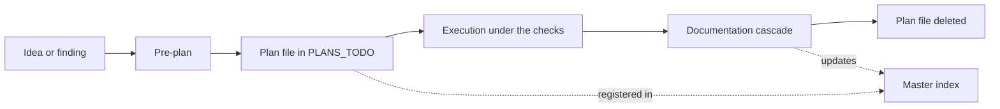

# Documentation map

In the private repository the documentation sits next to the code: 117 Markdown
documents under `docs/` (about 30,000 lines), a changelog, an architecture decision
log and an instruction layer for coding agents. Most of it is product and business
material, so this snapshot does not ship the content. Included: this map, the feature
playbook and three example plans.

## What is in this directory

| Path | What it is |
| --- | --- |
| `README.md` | This map. |
| [`ADD_NEW_FEATURE_PLAYBOOK.md`](ADD_NEW_FEATURE_PLAYBOOK.md) | How a feature travels from the kernel contract to the backend slice to the frontend feature. English rendering of the private playbook, checked against the code for this snapshot. |
| [`PLANS_TODO/_MASTER_IMPLEMENTATION_INDEX.md`](PLANS_TODO/_MASTER_IMPLEMENTATION_INDEX.md) | The roadmap index, condensed. |
| [`PLANS_TODO/_PLAN_TEMPLATE.md`](PLANS_TODO/_PLAN_TEMPLATE.md) | The template every plan starts from. |
| [`PLANS_TODO/PLAN_STYLIST_GEO_FIELDS.md`](PLANS_TODO/PLAN_STYLIST_GEO_FIELDS.md) | A pending plan: a cross-stack feature, not started. |
| [`PLANS_TODO/PLAN_PUSH_NOTIFICATIONS.md`](PLANS_TODO/PLAN_PUSH_NOTIFICATIONS.md) | A deferred plan: parked with its reasons and a re-entry condition. |
| [`PLANS_TODO/PLAN_PAYMENT_DATA_HYGIENE.md`](PLANS_TODO/PLAN_PAYMENT_DATA_HYGIENE.md) | A plan at the end of its life: code delivered, manual verification open. |

The three plans are real ones, condensed and translated.

## The private tree

Names and purpose only. Nothing below except the playbook and the plans workflow is
included here.

```
docs/
  README.md                     map and entry rules for a new agent session
  ADD_NEW_FEATURE_PLAYBOOK.md   cross-stack feature process (included)
  BACKEND_DX_GUIDE.md           backend recipes: handler factory, IO layer, sweeps, env, domain errors
  FRONTEND_DX_GUIDE.md          frontend conventions: data layer, component levels, baselines, accessibility
  DECISION_LOG.md               architecture decision records, append only (20 so far)
  DEPLOYMENT.md                 topology and deploy procedures
  RUNBOOK.md                    diagnostics, common failures, rollback
  INCIDENT_RESPONSE.md          severity levels, communication, post-incident review
  LOGGING.md                    the two log stores (application log, event log) and the verbose flag
  STRIPE_DEV.md                 local Stripe development
  DOMAIN/
    DOMAIN_SSOT.md              single source of truth for business rules
    business/                   pricing, finance, legal
    marketing/                  positioning, content, store listings, glossary in three languages
    product/                    feature specs, email lifecycle, analytics plan, moderation policy
  PLANS_TODO/                   roadmap index, plan template, one file per live plan (illustrated here)
  SECURITY/                     breach response, secrets rotation
  TESTS/                        testing strategy
  MEMORY_AI/                    persistent notes per agent role, read when a session starts
  _REVIEWS/                     findings from review passes, open items only
  _TRACKERS/                    session trackers, deleted when the session ends
```

Outside `docs/`, also private: `AGENTS.md` (the entry point and rule set for coding
agents, about 580 lines), `CHANGELOG.md` (history with the reasoning behind each
change, about 2,500 lines with its archive) and `DESIGN.md` (the design system).

## How the documents are used



Before any change, three documents are read in this order:

1. Domain document: the business rule.
2. Master index: whether a plan already covers the work, and its state.
3. Playbook: the order in which the layers are touched.

While the work runs, the checks are the compiler in both apps, the unit tests, the
audit suite and the git hooks. A plan is executed step by step, often by coding agents
under one orchestrating session, and a step is not done until the checks pass.

After the change, the documentation cascade is part of the definition of done:

1. The master index gets the new status.
2. Domain documents that described the old behaviour are corrected.
3. The changelog gets an entry with the reasoning.
4. The plan file is deleted. Git keeps its history.

## Sources of truth

| Question | Source |
| --- | --- |
| What is the business rule? | The private domain document. |
| What are the plan limits? | `.shared-kernel/policies/pricing.policy.ts`, read by both apps. Prices come from Stripe only. |
| What is the API contract? | `.shared-kernel/` (routes, DTOs, validators, events, permissions). |
| Why was it built this way? | The decision log, and `DECISION` comments at the place in code where the question would come up again. |

Each fact is stored once and referenced elsewhere. Several audits fail when a copy
appears.

## Lifecycles

| Document | Lives until |
| --- | --- |
| Plan | The work is done. Then it is deleted. |
| Review file | Its last open item is closed. It never holds a historical report. |
| Session tracker | The session ends. |
| Decision record | Never deleted. Append only. |
| Agent memory | Rewritten when a lesson stops being true. |

## Documents that live next to the code

These are part of the snapshot. They are written mostly in Polish, the working
language of the project, mixed with English, and are left as they are. Some link to
private documents that are not included.

| Path | Subject |
| --- | --- |
| `.shared-kernel/SHARED_KERNEL_GUIDE.md` | The shared kernel: layout, key files, workflow, naming, traps. |
| `web-1/README.md` | Backend overview. |
| `web-1/src/application/README.md` | Backend infrastructure layer. |
| `web-1/src/domain/README.md` | Backend domain layer: slices, operation results, event logging. |
| `main/src/UI/UI_ARCHITECTURE.md` | Frontend architecture: stack, layout, conventions, query pattern. |
| `main/src/UI/components/ATOMIC_LAYERS.md` | Component levels and what each may import. |
| `main/src/UI/NATIVE_INTEGRATION_GUIDE.md` | The native wrapper bridge. |
| `tests/README.md` | Test tiers and structure. |
| `tests/audit/README.md` | The audit suite: every audit and what it guards. |
